

# CentHR

## One HR Platform for All Group Entities

### Functional Overview for the Board of Directors and Senior Management

 

| | |
|---|---|
| **Document type** | Functional overview (non-technical) |
| **Audience** | Board of Directors, senior management |
| **Covers** | CentHR as built today, plus clearly marked opportunities |
| **Group entities** | OmniRetail · Omnipay · Summit · Movam · OmniHaven · Traction |
| **Date** | November 2026 |

 

> **How to read this document.** Sections 1 and 2 explain what CentHR is and why it exists. Sections 3 to 9 show how people use it each day. Sections 10 to 12 cover the value, the roadmap and an executive summary. Everything in Sections 1 to 10 describes features that exist in the application today. Ideas for the future appear only in Section 11, under a separate heading.

> **About the screenshots.** The screenshots come from the CentHR demonstration environment. The company and employee names in them are sample data, not live records from OmniRetail, Omnipay, Summit, Movam, OmniHaven or Traction.

---

## Table of Contents

1. [Introduction to CentHR](#1-introduction-to-centhr)
2. [Multi-Company and Multi-Site Operations](#2-multi-company-and-multi-site-operations)
3. [Application UI and User Experience](#3-application-ui-and-user-experience)
4. [Employee Management – Complete Business Flow](#4-employee-management--complete-business-flow)
5. [Data Migration Tool – Complete Functional Explanation](#5-data-migration-tool--complete-functional-explanation)
6. [Centralized HR Operations](#6-centralized-hr-operations)
7. [Centralized Monitoring and Operational Control](#7-centralized-monitoring-and-operational-control)
8. [User Roles and Responsibilities](#8-user-roles-and-responsibilities)
9. [End-to-End Business Workflows](#9-end-to-end-business-workflows)
10. [Business Benefits](#10-business-benefits)
11. [Current Capabilities and Future Opportunities](#11-current-capabilities-and-future-opportunities)
12. [Final Executive Summary](#12-final-executive-summary)

---

## 1. Introduction to CentHR

### 1.1 What CentHR is

CentHR is the group's **central HR management platform**. HR teams use it to manage the employees, attendance, leave and payroll of all six group entities (**OmniRetail, Omnipay, Summit, Movam, OmniHaven and Traction**), and of any entity the group adds later, in one place.

Each company keeps its own HR system (its "site"). CentHR sits above these sites. When HR records a change in CentHR, CentHR sends it to the correct company's site. Each company's own records stay complete and up to date, and nobody has to enter the same information twice.

### 1.2 Why it was introduced

Before CentHR, each company ran HR in its own system. Management had no single view across the group. HR staff who supported more than one company had to log in to several systems, repeat the same entries, and reconcile figures by hand.

### 1.3 The business problems it solves

| Problem without CentHR | How CentHR addresses it |
|---|---|
| Six separate systems, six logins, six ways of working | One application with one consistent set of screens for every group entity |
| The same employee information typed into more than one system | Information is entered once in CentHR and sent automatically to the right company's site |
| No reliable group-wide view of headcount, attendance or leave | One dashboard and filterable lists that cover every company the user can access |
| Errors between systems go unnoticed | Every transfer is logged, failures are flagged and named users are alerted |
| Moving historical HR data is slow and risky | A guided Data Migration Tool brings existing records from a company's site into CentHR, with progress tracking and an audit trail |
| Payroll errors are found after payment | Pre-audit checks flag problems (for example, a missing salary structure or a zero base salary) before payroll is run |

### 1.4 How it centralizes HR across companies

- **One employee register.** Every employee of every company is held in CentHR. Each one belongs to exactly one company, and employee IDs carry a company prefix.
- **One set of HR processes.** Attendance, leave, shifts, salary structures and payroll all use the same screens, whatever the company.
- **Automatic distribution.** CentHR knows which site belongs to which company. When a record is created or changed, CentHR sends it to that company's site in the background.
- **Central oversight.** Administrators can see, in one place, which transfers worked, which failed and why.

### 1.5 How it reduces manual work and improves visibility

- Records are entered **once**, not once per system.
- **Bulk tools** assign shifts and salary structures to many employees in one step.
- **Attendance is marked automatically** when an employee checks in.
- **Yearly leave and monthly Annual Leave are credited automatically** under the leave policy.
- **Excel export and import** handle salary reviews and salary slip uploads.
- The **dashboard** shows open approvals, today's attendance and leave usage at a glance.

### 1.6 What management gains

| For management, CentHR means… |
|---|
| One source of truth for HR information across OmniRetail, Omnipay, Summit, Movam, OmniHaven and Traction |
| Consistent processes and policies that are applied the same way each time |
| Faster, more confident decisions, based on current group-wide information |
| Clear accountability: every change and every transfer is recorded |
| Less administrative effort, so HR teams can spend time on people, not paperwork |

---

## 2. Multi-Company and Multi-Site Operations

### 2.1 The business model

The group has six independent entities today: OmniRetail, Omnipay, Summit, Movam, OmniHaven and Traction. Each one has its own HR system (its site), its own employees and its own responsibilities. CentHR does not replace these sites. It **connects** them and gives the group one place to manage HR.

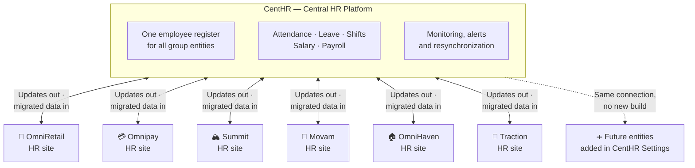

*Figure 2.1 – CentHR at the centre of the group. Day-to-day changes flow **out** from CentHR to each company's site. Existing historical records can be brought **in** from a company's site with the Data Migration Tool.*

### 2.2 How each company stays independent

| Principle | What it means in practice |
|---|---|
| **Separate company sites** | OmniRetail, Omnipay, Summit, Movam, OmniHaven and Traction each keep their own HR site and records. |
| **One company per employee** | Every employee in CentHR belongs to one company. Employee IDs carry the company's prefix, for example `OR-EMP-00012`, and are numbered separately for each company. |
| **Company-specific delivery** | A Movam employee's record goes only to the Movam site. It never goes to OmniRetail, Omnipay, Summit, OmniHaven or Traction. |
| **Group-wide settings where they make sense** | Some shared definitions have no company of their own, such as shift types and salary components. CentHR sends these to every connected site, so every entity uses the same definitions. |
| **Company-specific access** | Users can be limited to the companies they are responsible for. The dashboard and lists then show only those companies. |

### 2.3 How information is shared between CentHR and the sites

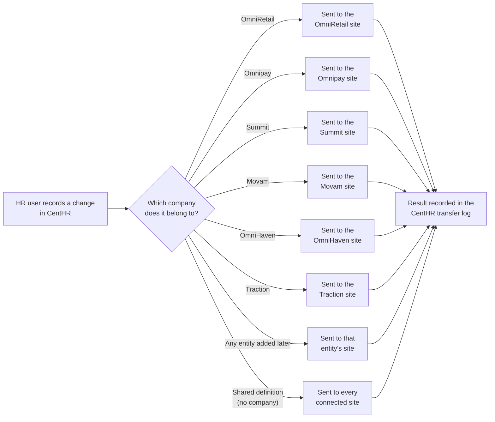

*Figure 2.2 – Routing of changes. CentHR uses each record's company to decide where it goes, and logs every attempt.*

**Information that CentHR sends to the company sites automatically**

| Area | What is shared |
|---|---|
| Employees | New employees, updates to employee details, and removal of employees |
| Leave | Approved leave applications, cancellations, and leave allocations |
| Attendance | Submitted attendance, cancellations, and employee check-ins |
| Shifts | Shift types (shared with all sites) |
| Salary | Salary components, salary structures, salary structure assignments, additional salary |
| Payroll | Payroll entries (payroll runs) |

**Information that CentHR can bring in from a company site, on request**

The Data Migration Tool (Section 5) brings existing records from a company's site into CentHR. It covers 15 categories, from the chart of accounts and employees to salary slips and payroll runs.

### 2.4 Connecting a company

A central administrator connects each company once. In **CentHR Settings**, the administrator enters the company's site address and its access credentials. In the same place, the administrator lists the people who should be alerted when a transfer fails.

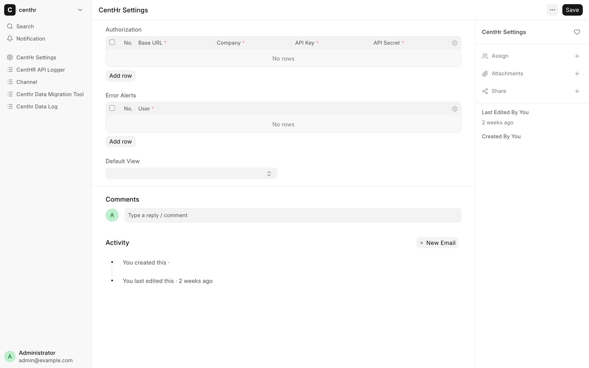

*Figure 2.3 – CentHR Settings. Each row under **Authorization** links one company to its HR site. Users listed under **Error Alerts** receive a notification whenever a transfer to a company site fails. (Shown empty in the demonstration environment.)*

### 2.5 Adding more entities

The six entities above are not a fixed limit. CentHR is built so the group can **add more entities at any time, without new development**.

| Step | What happens |
|---|---|
| 1 · Create the company | An administrator creates the new entity as a company in CentHR, with its own employee ID prefix and numbering series |
| 2 · Connect its site | The administrator adds one new row under **Authorization** in CentHR Settings, with the entity's site address and access credentials |
| 3 · Bring in its history | The Data Migration Tool (Section 5) copies the entity's existing records into CentHR |
| 4 · Go live | From then on, every change for that entity goes to its site automatically. Shared definitions, such as shift types and salary components, also go to the new site |

The new entity then appears in the same dashboard, lists, filters, transfer log and access controls as the existing six. Section 9.1 shows this process as a workflow.

---

## 3. Application UI and User Experience

### 3.1 Getting in

CentHR is a modern web application that opens in any browser. HR staff and employees who have a CentHR login open CentHR from the group's apps screen or go directly to its address.

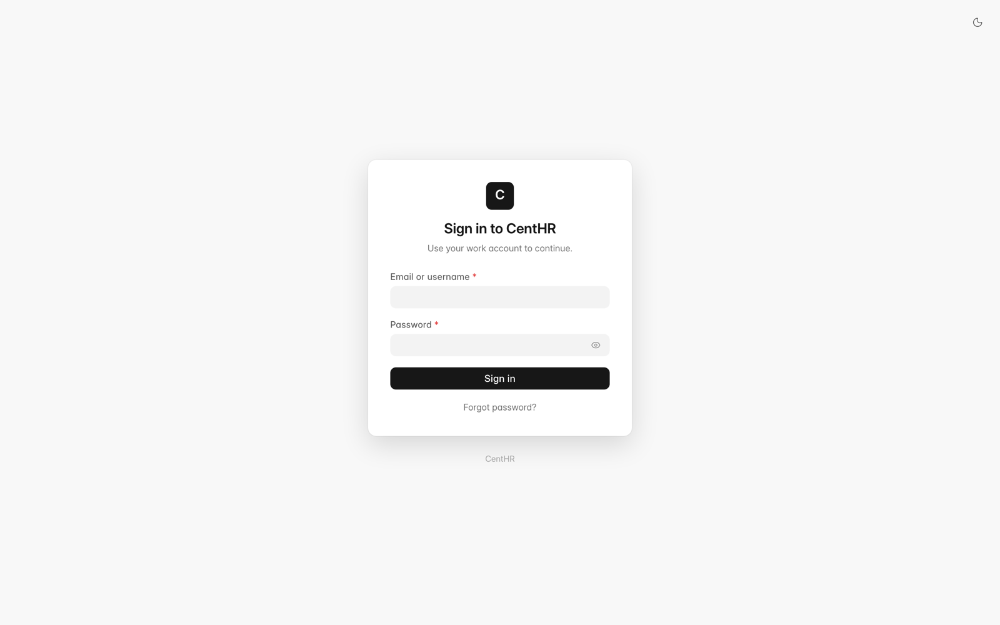

*Figure 3.1 – The CentHR sign-in page.*

### 3.2 How the application is organised

Every screen has the same layout. A navigation menu on the left holds three groups of modules. Users only see the modules their role allows.

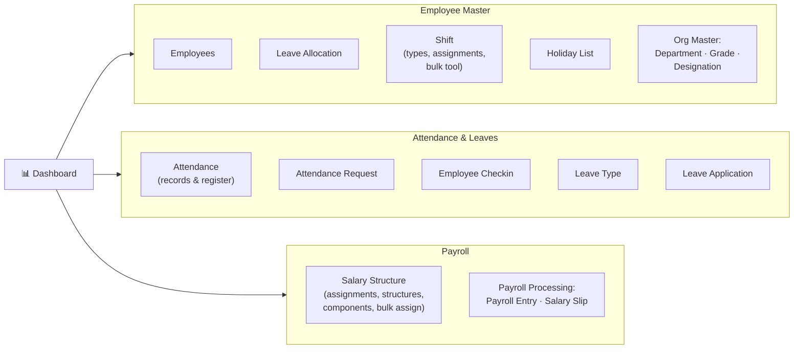

*Figure 3.2 – Navigation map of CentHR. The Dashboard is the starting point. The three menu groups match the three main areas of HR work.*

Common features on every screen:

- **Search and filters** by company, department, employee, status and date.
- **Status badges** in colour, so open, approved, rejected and pending items stand out.
- **One-click navigation** from a summary figure to the records behind it.
- An **activity history** on each record that shows who changed what and when, with space for comments.
- **Light and dark display themes**, and a menu that can be collapsed on smaller screens.
- **Role-aware actions.** Buttons such as Approve, Submit or Delete appear only for users who are allowed to use them.

### 3.3 The Dashboard

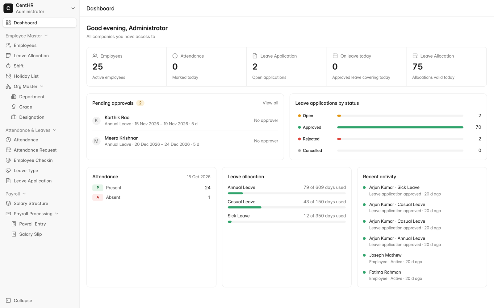

*Figure 3.3 – The CentHR Dashboard. HR users see "All companies you have access to"; other users see only their own records.*

| | |
|---|---|
| **Purpose** | The day's starting point: a group-wide snapshot of HR activity |
| **What management sees** | Active employees · attendance marked today · open leave applications · employees on leave today · valid leave allocations · pending approvals · leave applications by status · today's attendance by status · leave used against leave allocated, by leave type · recent activity |
| **Actions** | Click any figure or item to open the underlying records |
| **Day-to-day value** | Shows at a glance what needs a decision and how the workforce is placed today |

### 3.4 Employee Master

#### Employees

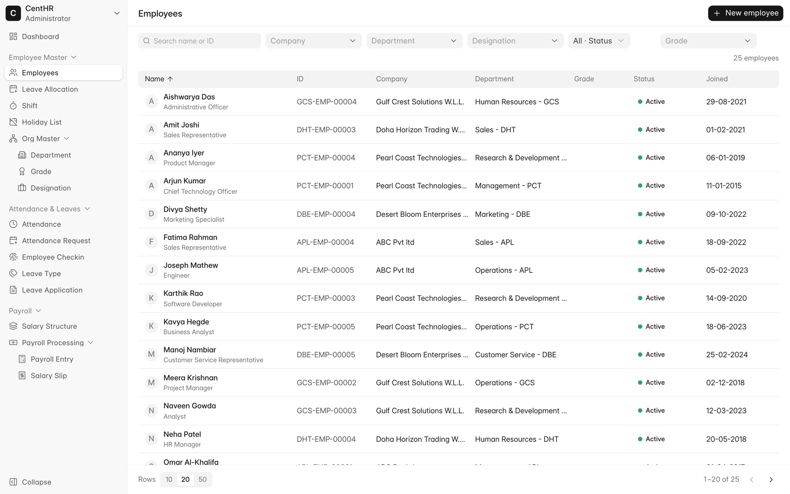

*Figure 3.4 – The employee register for all companies, filterable by company, department, designation, grade and status.*

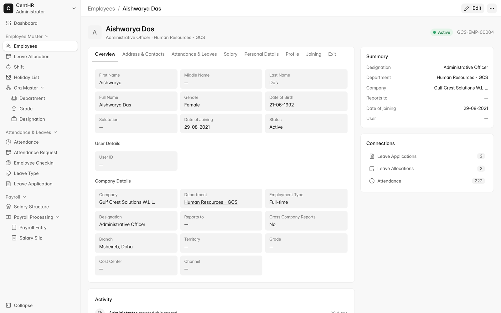

*Figure 3.5 – An employee record. Tabs hold contact, attendance and leave, salary, personal, joining and exit details. The side panel gives a summary and links to the employee's leave applications, allocations and attendance. When the employee's company has a connected site, the side panel also shows the **Entity sync** status, which tells you whether the record reached that company's site.*

| | |
|---|---|
| **Purpose** | Hold one complete, current record for every employee in the group |
| **What management sees** | Who works where, in which department and grade, who they report to, and whether they are active |
| **Actions** | Create, edit or remove employees; open their leave, allocation and attendance history |
| **Day-to-day value** | A single, reliable employee register for every group entity |

#### Leave Allocation, Shift, Holiday List and Org Master

| Screen | What it is for | Key actions |
|---|---|---|
| **Leave Allocation** | How many days of each leave type each employee is entitled to, and for which period | Create allocations; filter by company, employee, leave type and status; see balances |
| **Shift** | The working-hours patterns (shift types) used across the group, and who is assigned to which shift | Create shift types; assign shifts one by one or in bulk; process shift requests (approve or reject) |
| **Holiday List** | Public holidays and weekly days off for each year | Create holiday lists; add weekly offs and country holidays automatically |
| **Department / Grade / Designation** | The organisation structure: departments, staff grades (cadres) with default pay, and job titles | Create and maintain; see how many active employees use each one |

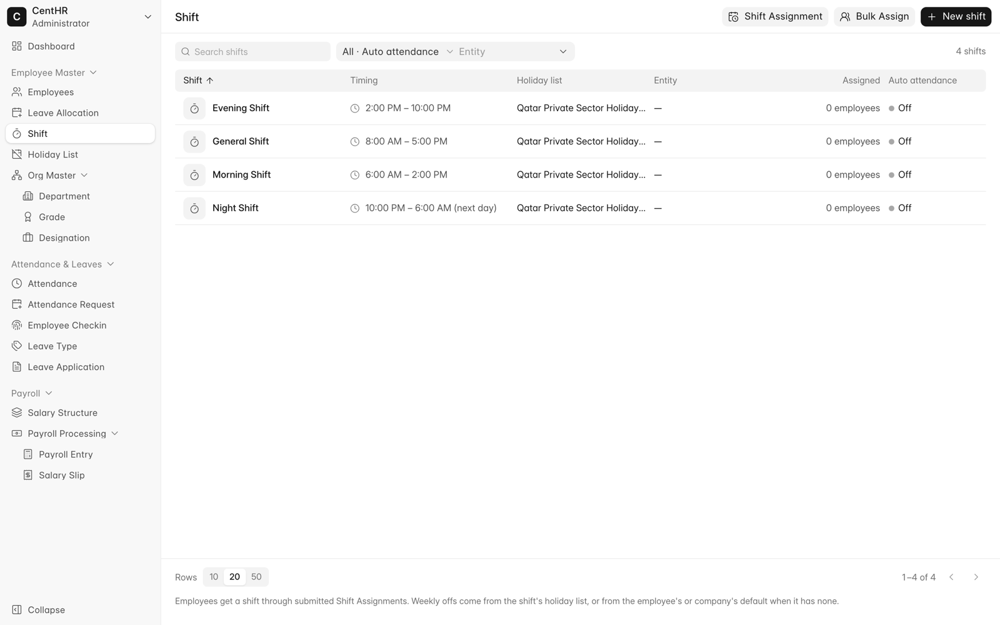

*Figure 3.6 – Shift types with timings, holiday list and whether attendance is marked automatically from check-ins. The **Bulk Assign** button opens the Shift Assignment Tool.*

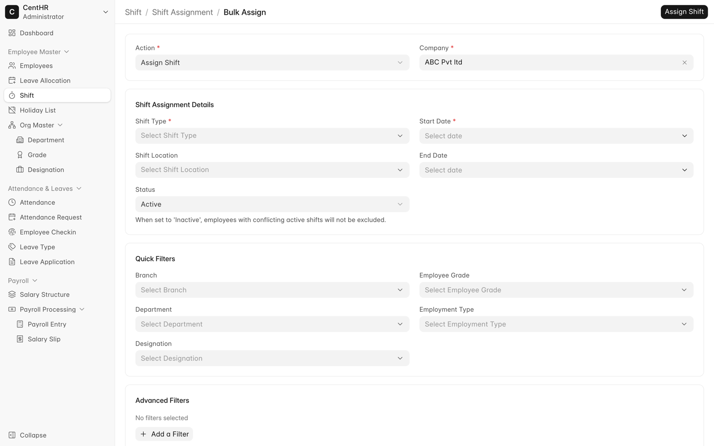

*Figure 3.7 – The Shift Assignment Tool assigns a shift to many employees at once, using filters such as department or branch. It can also approve or reject shift requests in bulk.*

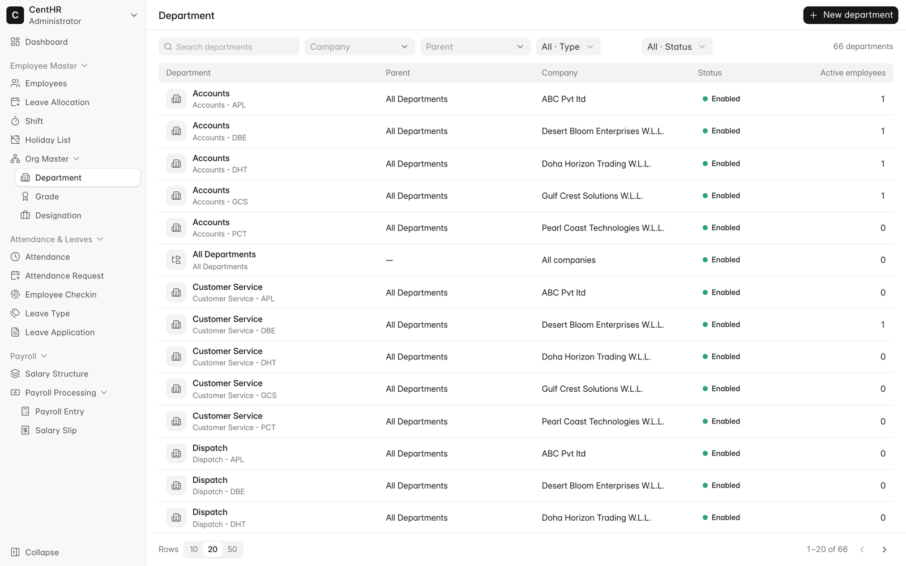

*Figure 3.8 – Departments across all companies, with parent departments and active-employee counts.*

<b>More Employee Master screens</b> (click to expand)

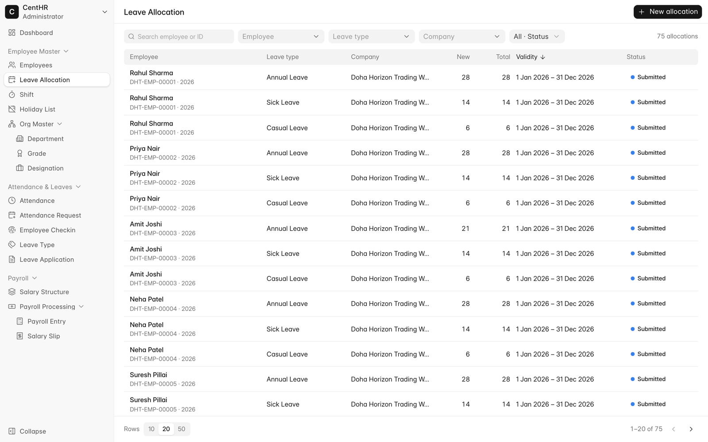

*Leave allocations, with validity period and status.*

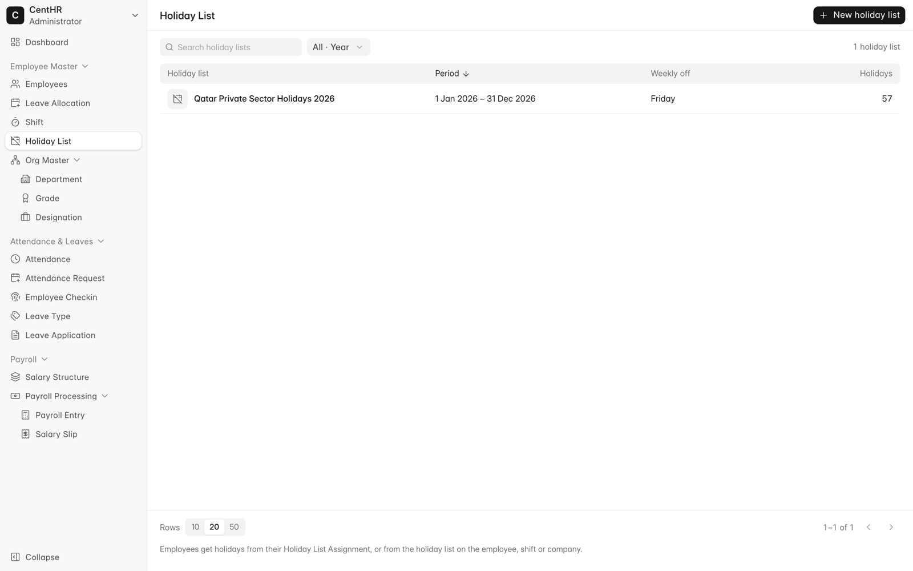

*Holiday lists, with period, number of holidays and weekly off days.*

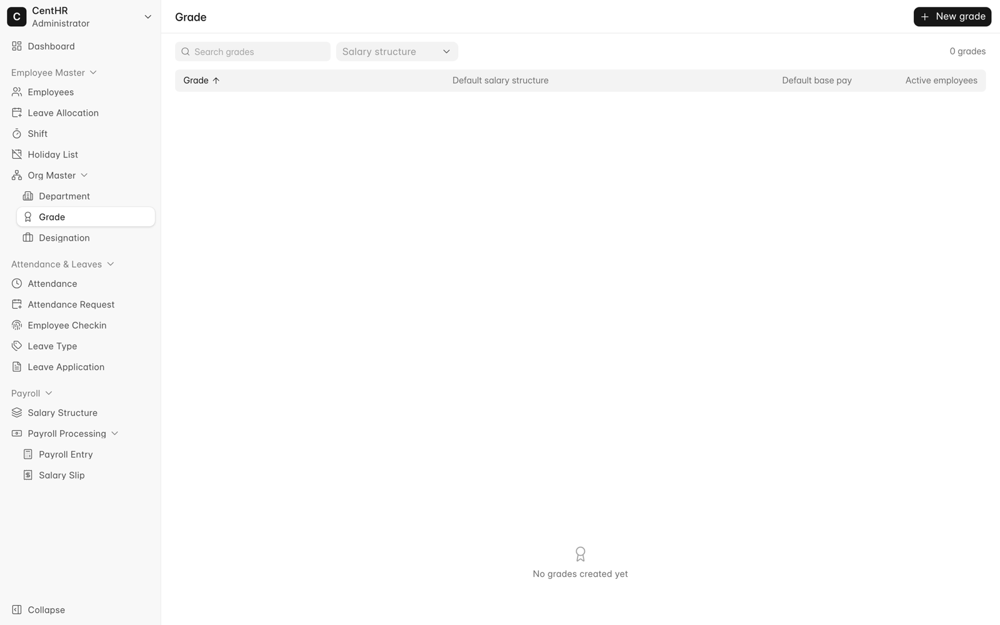

*Employee grades (cadres), with default salary structure and default base pay.*

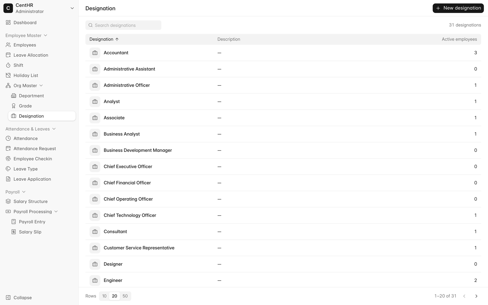

*Designations (job titles), with active-employee counts.*

### 3.5 Attendance & Leaves

#### Attendance

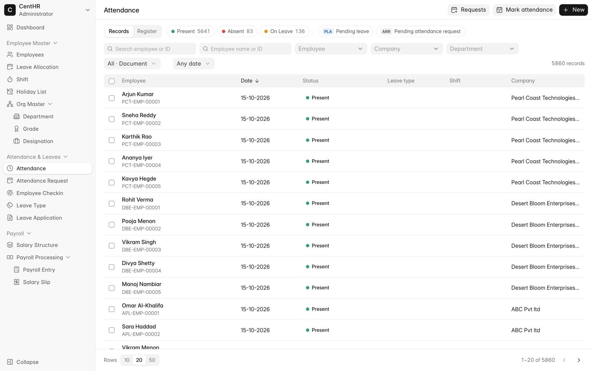

*Figure 3.9 – Attendance records across companies, with totals by status (Present, Absent, On Leave). Markers show days that have a leave application or attendance request still waiting for approval.*

| | |
|---|---|
| **Purpose** | Record who was present, absent, on leave, on half day or working from home each day |
| **What management sees** | Attendance totals; a **Register** view (a monthly grid for each employee, with holidays and weekly offs shaded); pending leave and pending requests for each day |
| **Actions** | Mark attendance for one or many employees and days; submit or cancel in bulk; open requests |
| **Day-to-day value** | A fast, accurate attendance picture that follows each company's payroll cycle |

#### Attendance Request, Employee Checkin, Leave Type and Leave Application

| Screen | What it is for | Key actions |
|---|---|---|
| **Attendance Request** | Employees ask to correct their attendance, for example a missed check-in, work from home or on duty | Raise a request; the employee's line manager approves or rejects it; filter by "Waiting for me" |
| **Employee Checkin** | Each check-in and check-out time recorded for employees | View and filter by company, employee and log type. The first check-in of a day marks the employee Present automatically |
| **Leave Type** | The group's leave types and their rules (maximum per year, maximum continuous days, when an employee becomes eligible) | Create and maintain leave types; see their usage |
| **Leave Application** | Employees' leave requests and their approval status | Apply, approve or reject in a two-step approval: head of department first, then HR |

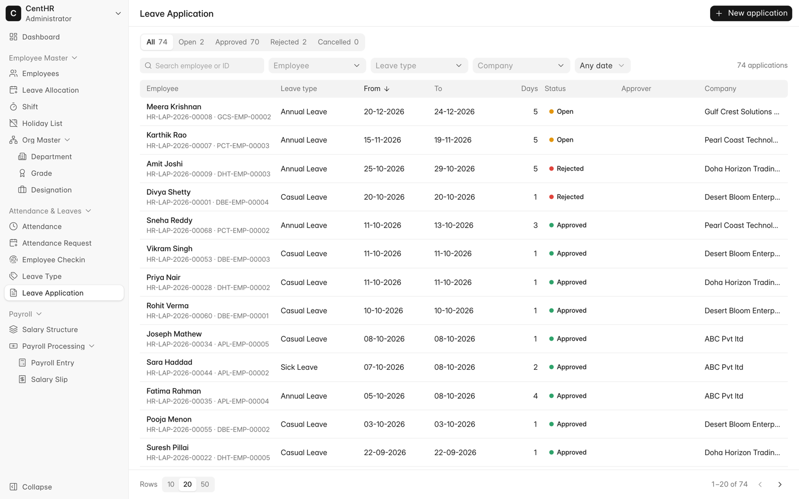

*Figure 3.10 – Leave applications, with leave type, dates, number of days, approver and status.*

<b>More Attendance & Leaves screens</b> (click to expand)

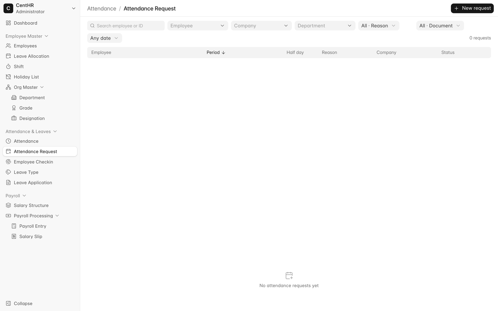

*Attendance requests, with a "Waiting for me" filter for line managers.*

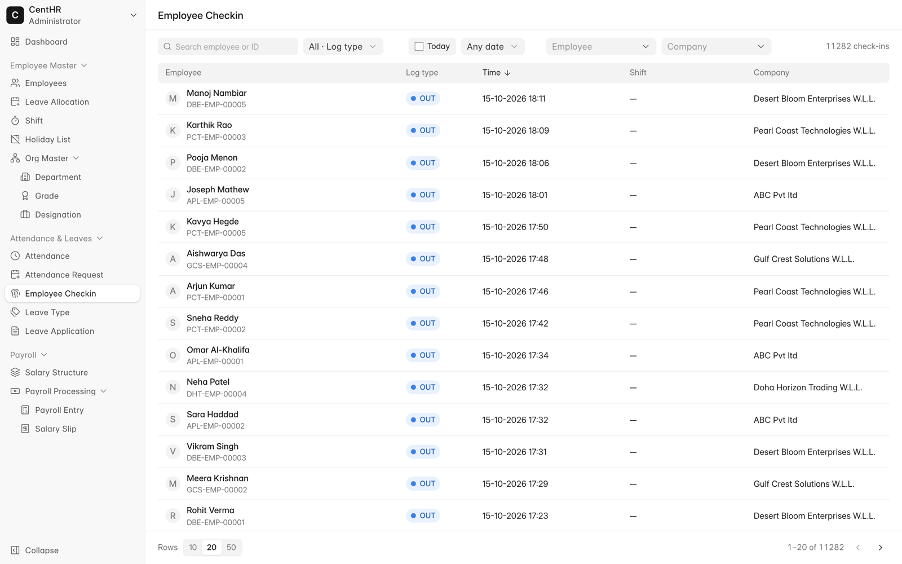

*Employee check-in log.*

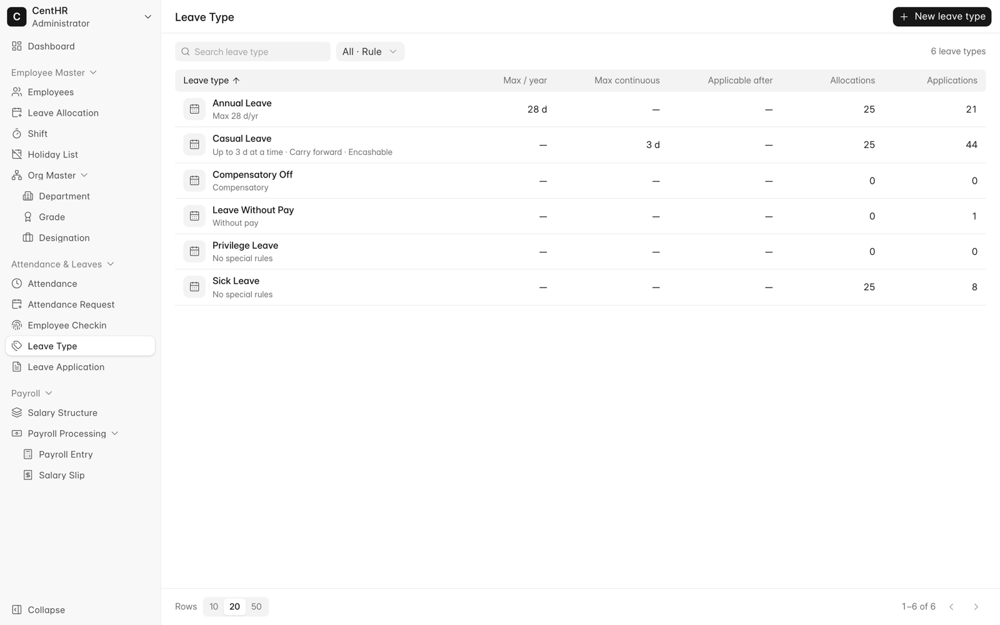

*Leave types and their rules.*

#### Self-service forms for employees

Employees can submit a **Leave Application** or an **Attendance Regularization Request** through simple web forms (the regularization form lets an employee list several days, each with its own reason, and CentHR creates one request per day for the line manager), without needing full system access. To confirm the employee's identity, CentHR sends a **one-time code to the employee's company email address**, and the form is accepted only after the employee enters that code.

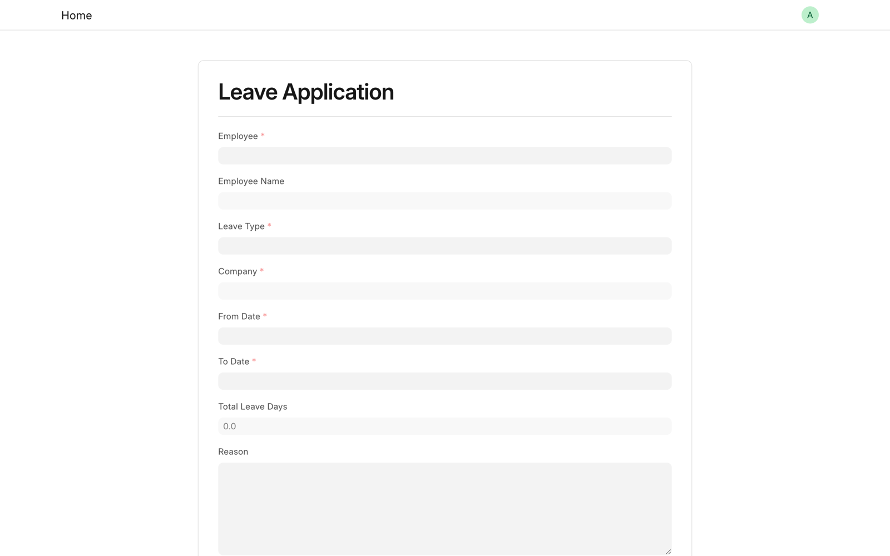

*Figure 3.11 – The leave application web form.*

### 3.6 Payroll

#### Salary Structure

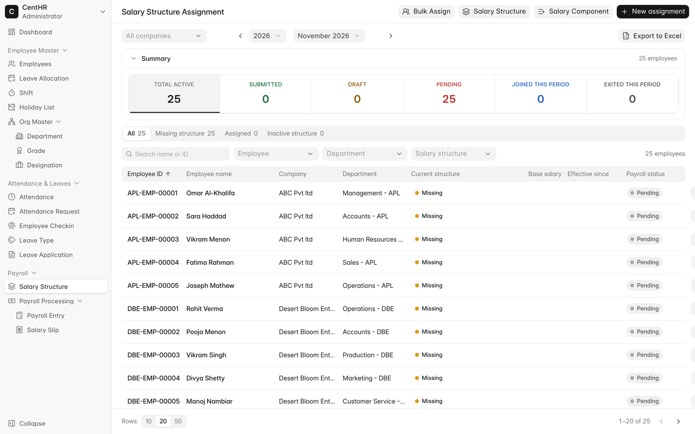

*Figure 3.12 – The salary structure overview for a pay period. It counts active employees, slips submitted, slips in draft, employees pending, joiners and leavers. It lists every employee with their current structure, base salary and payroll status. The top bar opens **Bulk Assign**, **Salary Structure** and **Salary Component**. **Export to Excel** downloads the view.*

| | |
|---|---|
| **Purpose** | Decide how each employee is paid: which salary structure applies, from which date, and on what base |
| **What management sees** | Who has a salary structure and who is missing one, for any company and period |
| **Actions** | Assign structures one at a time or in bulk; maintain salary structures and salary components; export to Excel |
| **Day-to-day value** | Gaps are found before payroll runs, not after |

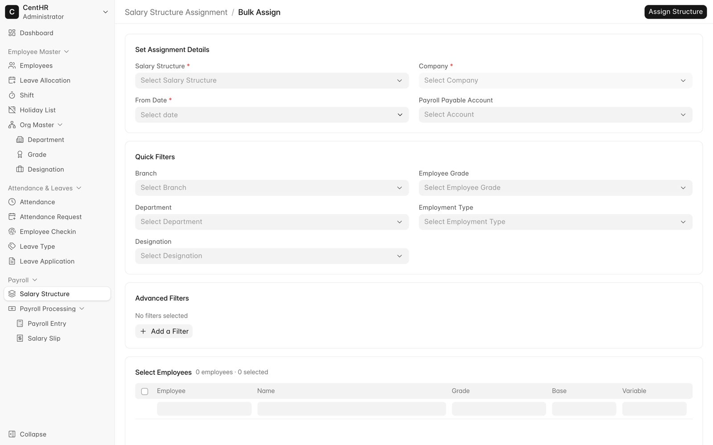

*Figure 3.13 – Bulk Salary Structure Assignment: choose a structure and a start date, select employees (each grade's default base pay is suggested), adjust base and variable pay, and assign them all in one step.*

#### Payroll Processing

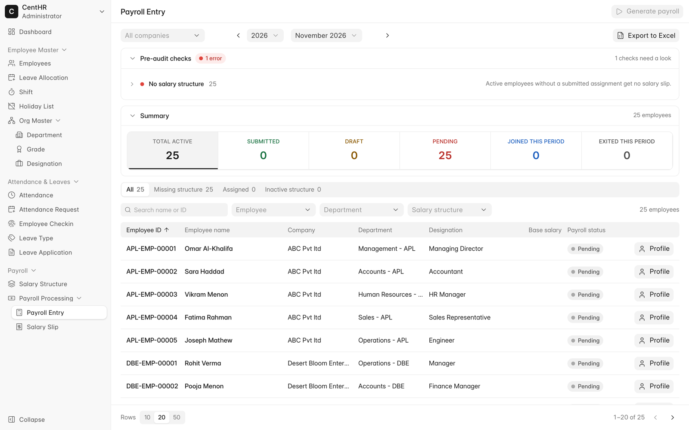

*Figure 3.14 – Payroll Processing for a period. **Pre-audit checks** flag issues before payroll is run. In this example, 25 employees have no salary structure, so they would get no salary slip. **Generate payroll** starts the run.*

| | |
|---|---|
| **Purpose** | Run payroll for each company and pay period, step by step, with checks before anything is paid |
| **What management sees** | Payroll status for each employee; the stage each payroll run has reached; problems found by the pre-audit checks |
| **Actions** | Generate payroll · create and submit salary slips · prepare the bank payment entry · release withheld salaries · cancel a run · import salary slips from Excel · export to Excel |
| **Day-to-day value** | A controlled, visible payroll process that catches errors before payday |

<b>More Payroll screens</b> (click to expand)

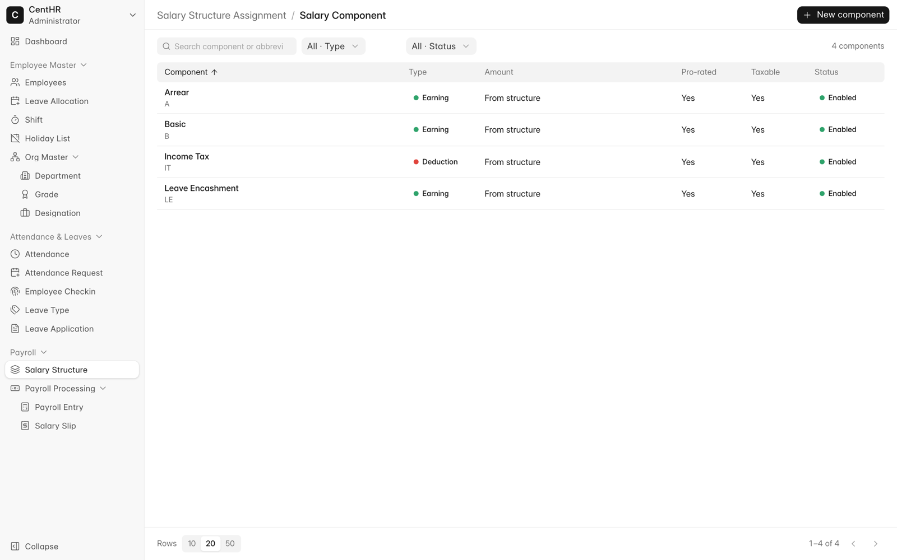

*Salary components (earnings and deductions), with type, whether they are taxable and whether they are pro-rated.*

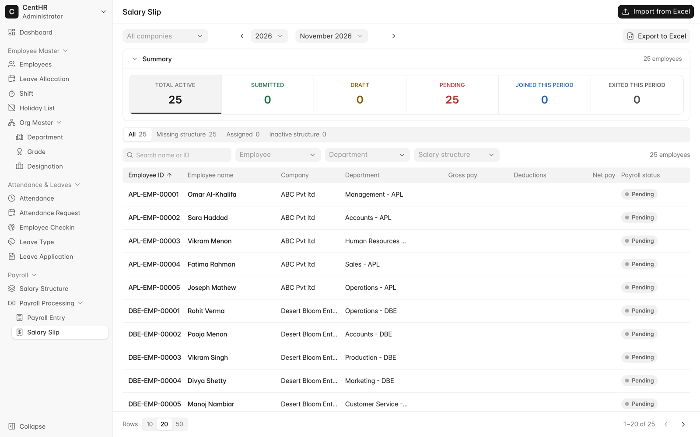

*Salary slips for the period, with an option to import them from Excel.*

### 3.7 Administration screens

Central administrators manage connections and monitoring in a separate administration area.

| Screen | Purpose |
|---|---|
| **CentHR Settings** | Connect each company to its site and choose who receives failure alerts (Figure 2.3) |
| **CentHR API Logger** (shown here as the *Transfer Log*) | A record of every transfer between CentHR and the company sites, with **Resync** for failures (Section 7) |
| **Centhr Data Migration Tool** | Bring existing records from a company's site into CentHR (Section 5) |
| **Centhr Data Log** | A summary of each migration run (Section 5) |

### 3.8 A typical user journey

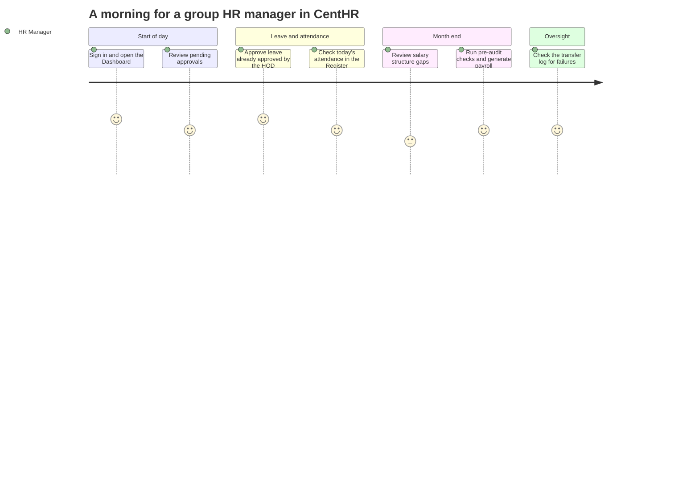

*Figure 3.15 – How a user typically moves through CentHR during a working day.*

---

## 4. Employee Management – Complete Business Flow

### 4.1 The employee lifecycle in CentHR

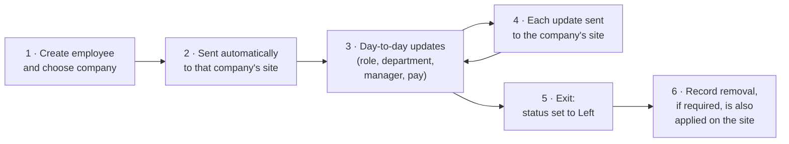

*Figure 4.1 – The employee lifecycle. Every step that changes the record is reflected on the company's site automatically.*

### 4.2 Step by step: creating an employee

*Example: HR hires **Aisha Khan** as a Store Supervisor at **OmniRetail**.*

| Step | What the HR user does | What CentHR does |
|---|---|---|
| 1 | Opens **Employees → New employee** | Opens an empty employee form |
| 2 | Enters name, gender, date of birth and date of joining | — |
| 3 | Selects the **Company: OmniRetail** | Gives the employee an OmniRetail ID, numbered in OmniRetail's own series |
| 4 | Fills in department, designation, grade, branch, territory, cost center, channel and company email | Checks that required details are complete |
| 5 | Selects the **Reports To** manager | Records the reporting relationship |
| 6 | Enters salary details: salary structure, base salary, start date and payroll payable account | These are required on every employee record |
| 7 | Saves | Sends the new employee to the **OmniRetail site** in the background and records the result |
| 8 | (Optional) Checks the **Entity sync** panel on the employee record | Shows *Success*, or *Failed* with a plain-language reason |

> **Built-in safeguard.** Before sending a new employee, CentHR checks that the details the company site needs (department, company email, territory, cost center and channel) are filled in. If any are missing, CentHR does not send the record. Instead it logs a clear message saying which details are missing, so HR can complete them and resend.

### 4.3 Updating employee information

*Example: **Movam** promotes **Daniel Osei** to Regional Manager and moves him to a new department.*

1. The HR user opens Daniel's record in CentHR and selects **Edit**.
2. The HR user changes the designation and department, then saves.
3. CentHR finds Daniel's matching record on the **Movam site** by his employee number and applies the same changes there.
4. The result appears in the transfer log and in the **Entity sync** panel.

If an update cannot find the employee on the company's site, for example because the original creation never reached it, CentHR records the failure clearly so that an administrator can resolve it.

### 4.4 Reporting managers, including across companies

Most employees report to a manager in their own company. CentHR also allows **cross-company reporting lines**, which are common in a group.

*Example: an **OmniHaven** finance officer reports to the Group Finance Controller, who is employed by **Summit**.*

| Step | Action |
|---|---|
| 1 | On the OmniHaven employee's record, HR ticks **Cross Company Reports** |
| 2 | HR selects **Summit** as the cross company. CentHR prevents the employee's own company from being selected here. |
| 3 | The **Reports To** list now offers only active Summit employees. HR selects the Group Finance Controller. |
| 4 | CentHR **automatically gives the Summit manager access** to this OmniHaven employee, so the manager can see and act on the employee's requests |
| 5 | If the reporting line changes, or the employee leaves, CentHR **removes that access automatically**. It keeps any access the manager still needs for other employees. |

### 4.5 Company-wise visibility

- Every list can be filtered by **company**, and every record shows which company it belongs to.
- HR users see **all companies they are allowed to access**. A user limited to OmniRetail sees only OmniRetail's employees and records.
- Each company's site receives **only its own employees**.

### 4.6 Employee movement between companies

| | Current position |
|---|---|
| **Supported today** | Cross-company **reporting lines** (Section 4.4). Each employee belongs to one company, and their record is kept up to date on that company's site. |
| **Not supported as a single action** | **Transferring** an employee from one company to another, for example from Movam to Summit, as one step. CentHR sends updates to the site of the employee's current company and finds the employee there by employee number. Changing the company on an existing record does not move the employee between sites. |
| **Current practice** | HR sets the employee to *Left* in the old company and creates a new employee record in the new company. CentHR sends the new record to the new company's site. |
| **Opportunity** | A guided inter-company transfer is listed in Section 11. |

### 4.7 Synchronization, failures and resynchronization

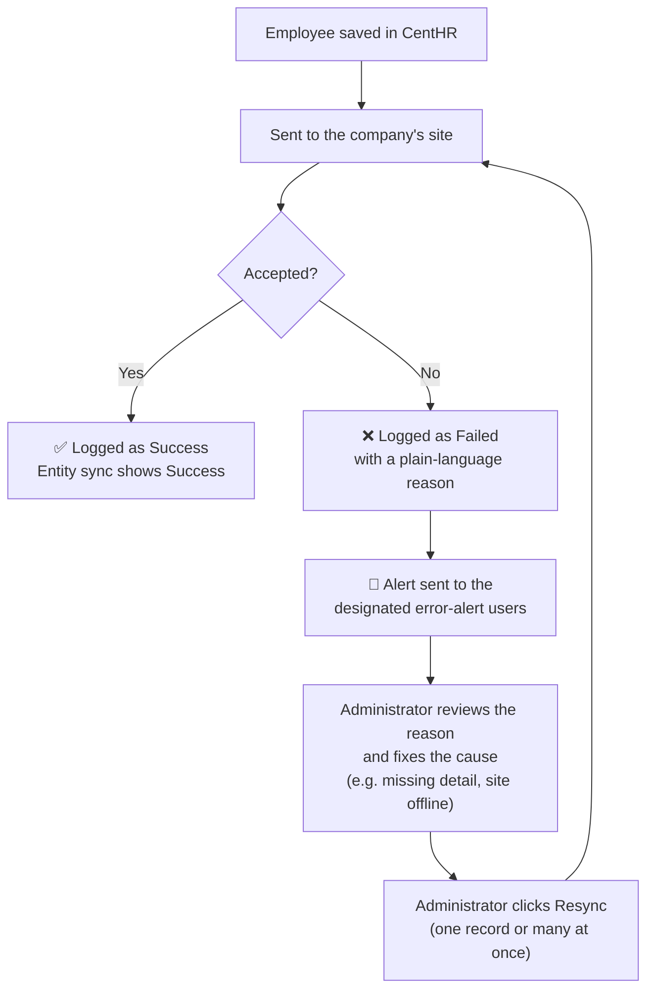

*Figure 4.2 – How failed employee updates are handled. Each failure can be resynced up to three times.*

Common failure reasons, in the plain language CentHR uses:

| Message type | Typical cause | Typical fix |
|---|---|---|
| Could not connect to the site | The company site is offline, or its address is wrong | Check the site, or correct the address in CentHR Settings, then resync |
| The site did not reply in time | The company site is slow or busy | Resync later |
| Authentication failed | The access credentials have changed | Update the credentials in CentHR Settings, then resync |
| The site rejected the data | A required value is missing or not valid on the site | Correct the record in CentHR, then save or resync |
| Missing fields required by the site | Department, company email, territory, cost center or channel is empty | Complete the employee record |

---

## 5. Data Migration Tool – Complete Functional Explanation

### 5.1 Why data migration is required

When a company joins CentHR, it already has years of HR history on its own site: employees, leave balances, attendance, salary structures, salary slips and payroll runs. Typing this in again would be slow and error-prone. The **Data Migration Tool** brings these records **from a company's own site into CentHR** in a controlled, monitored way. CentHR can then hold a complete picture from the first day.

### 5.2 Direction of migration: what the tool does today

> **Important clarification for the Board.**
> The Data Migration Tool copies records **from one company's own site into CentHR, for that same company**. For example, it copies OmniRetail's records from the OmniRetail site into CentHR under OmniRetail.
> - The **source** is the site connected to the selected company.
> - The **destination** is CentHR, under the same company.
>
> The tool does **not** copy records directly from one company to another, for example from OmniRetail to Movam. Section 5.10 explains how the cross-company scenarios work today.

### 5.3 What can be migrated

The tool has **15 categories** (one tab each). Because records depend on each other, the tool shows the order to follow:

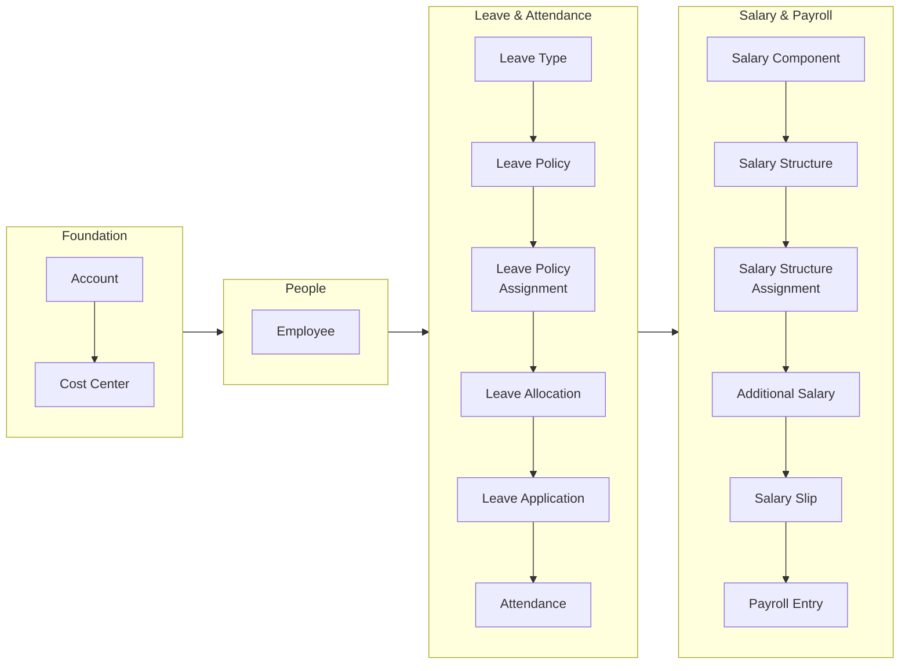

*Figure 5.1 – The recommended migration order. Each step depends on the steps before it. For example, leave allocations need the employees to exist first.*

| Category | Filters available |
|---|---|
| Account | Account type (Asset, Liability, Equity, Income, Expense) |
| Cost Center | — |
| Employee | Active, inactive or all |
| Leave Type, Leave Policy | — (shared across the site) |
| Leave Policy Assignment | Date range, employee |
| Leave Allocation | Date range, employee, leave type |
| Leave Application | Date range, employee, status |
| Attendance | Date range, employee, status |
| Salary Component, Salary Structure | — |
| Salary Structure Assignment | Date range, employee |
| Additional Salary | Employee, salary component |
| Salary Slip | Date range, employee |
| Payroll Entry | Date range |

### 5.4 Step 1: select the company (and so the source)

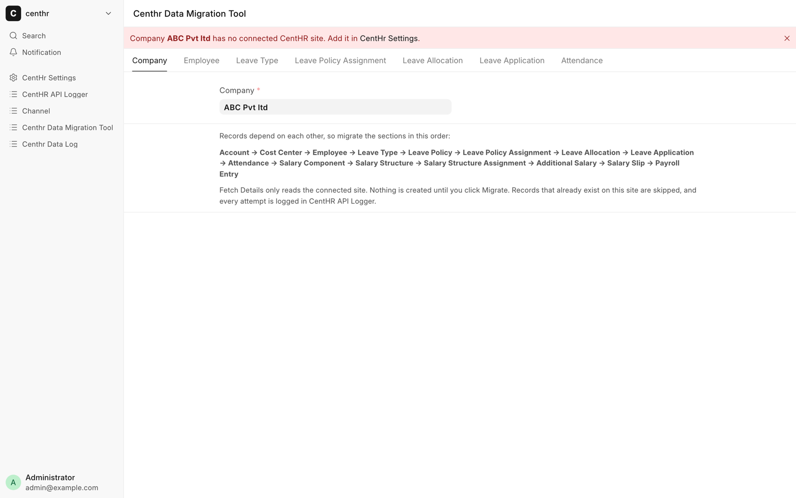

*Figure 5.2 – The Data Migration Tool. The administrator selects the company. The tool shows the migration order and explains that fetching only reads the company's site; nothing is created until the user chooses to migrate. If the selected company has no connected site, as in this demonstration environment, the tool says so and links to CentHR Settings.*

Selecting the company selects the source as well: the tool reads from the site connected to that company in CentHR Settings.

### 5.5 Step 2: choose a category and fetch records

1. Open the category tab, for example **Employee**.
2. Set filters if needed, for example *Active employees only*, or a date range for attendance.
3. Click **Fetch Details**. CentHR **reads** the matching records from the company's site and shows them in a table. **Nothing is changed or created at this stage.**

For each record fetched, the table shows the record's ID on the company's site, its key details, its **Migration Status**, and the matching **Record on This Site** in CentHR, if one exists. A summary at the top counts the records in each status.

| Migration status | Meaning |
|---|---|
| 🔵 **Pending** | Not yet in CentHR |
| 🟢 **Success** | Created in CentHR by the tool |
| ⚪ **Already Exists** | A matching record was already in CentHR, so it will not be duplicated |
| 🔴 **Failed** | The last attempt failed. Hover over it to see the reason |

### 5.6 Step 3: how information is matched and mapped

The tool does more than copy. It **maps** each record so it fits correctly in CentHR:

| What is mapped | How |
|---|---|
| **Employees** | Matched by **employee number**, the same key used when CentHR sends employees to the sites. Leave, attendance and salary records are linked to the correct employee in CentHR. |
| **Accounts and cost centers** | Matched by name and number in each company's chart of accounts and cost center structure |
| **Other references** (departments, leave types, structures and so on) | Linked to the record with the same name in CentHR |
| **Required references that do not exist yet** | The record is **not created**. It is marked *Failed* with a message such as "Leave Type X does not exist on this site. Migrate or create it first." |
| **Optional references that do not exist** | Left empty, with a note in the log |
| **Record IDs** | Kept the same as on the company's site, so a record has the **same ID in both places**. CentHR's numbering then continues after the copied IDs, so later records do not clash. |
| **Duplicates** | Records already in CentHR are detected and marked *Already Exists*, so nothing is copied twice |
| **Status** | Records that were final (submitted) on the source site are created as final in CentHR |
| **Attachments** | Not copied. File links point to the source site and would not work in CentHR. |

### 5.7 Step 4: start the migration

Two options are offered:

- **Migrate Selected:** migrate only the records the user has ticked.
- **Migrate Pending & Failed:** migrate everything not yet in CentHR, including earlier failures, in one action.

CentHR asks for confirmation, for example: *"Migrate 120 Employee records from the CentHR site to this site?"* The migration then runs in the background.

### 5.8 Step 5: monitor progress live

- A **progress window** shows *"x of y"* records processed, and the table updates each row's status live.
- The user can **Stop Migration** at any time. The current record finishes cleanly and the rest are marked *Stopped*.
- Only **one migration per category per company** can run at a time. This prevents the same records being migrated twice.
- **Each record stands alone.** If one record fails, the records already migrated stay in place, and the run continues with the next record.

### 5.9 Step 6: review results, correct errors and finish incomplete migrations

Every run creates a **Data Log** entry with the totals: records selected, succeeded, already existing and failed. The overall outcome is one of the following:

| Run outcome | Meaning |
|---|---|
| **Completed** | Every record succeeded or already existed |
| **Partially Completed** | Some records failed |
| **Failed** | All records failed |
| **Stopped** | A user stopped the run before it finished |

Each record in the log links to its **transfer log entry**, which holds the full reason for any failure.

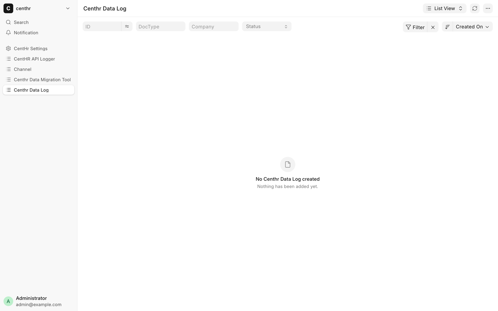

*Figure 5.3 – The list of migration runs (Data Log). Each run shows its category, company, outcome and totals. (Empty in the demonstration environment.)*

**Correcting errors and finishing incomplete migrations:**

1. Open the Data Log, or hover over the *Failed* status in the tool, to read the reason.
2. Fix the cause. Usually this means migrating a prerequisite first (for example, Employees before Leave Allocations) or creating a missing reference.
3. Either **resync** the failed record from the transfer log, or go back to the tool and click **Migrate Pending & Failed**. Only the remaining records are processed. Records that already succeeded are skipped automatically.

### 5.10 Illustrative business scenarios

> These scenarios show **how the group might use migration and related features**. They do **not** mean that every company-to-company combination is a single built-in operation. Each scenario states what is possible **today**.

| Scenario | Business situation | How it is handled today |
|---|---|---|
| **OmniRetail → Movam** | Several OmniRetail store staff move to Movam | 1) Use the tool to bring OmniRetail's history into CentHR, if not done yet. 2) In CentHR, mark the staff as *Left* in OmniRetail and create them as new Movam employees. CentHR sends the new records to the Movam site. Their OmniRetail history stays under OmniRetail. |
| **Movam → Summit** | A Movam department is absorbed by Summit | Same approach: Movam history is migrated into CentHR under Movam, and the people are re-created under Summit. Summit's site receives them automatically. |
| **Summit → OmniHaven** | OmniHaven takes over Summit's payroll setup | Summit's salary components are shared group-wide, so OmniHaven already has them. OmniHaven's salary structures are set up in CentHR under OmniHaven, often by using Summit's as a model, and are sent to the OmniHaven site. |
| **OmniHaven → OmniRetail** | An OmniHaven manager takes on line responsibility for OmniRetail staff | Not a migration. Use **cross-company reporting** (Section 4.4): OmniRetail employees report to the OmniHaven manager, who is given access automatically. |

### 5.11 End-to-end migration workflow

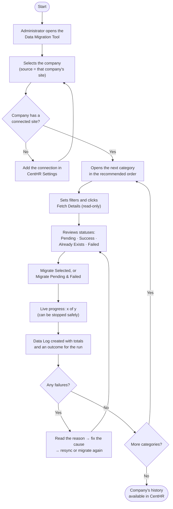

*Figure 5.4 – The complete migration process from start to finish.*

### 5.12 Existing capabilities versus suggested improvements

| ✅ Available today | 💡 Suggested improvements (see Section 11) |
|---|---|
| 15 migration categories, with a guided order | Copying directly from one company to another, with mapping of company-specific references |
| Read-only preview (Fetch Details) before anything is created | A single "migrate everything in order" action for onboarding a new company |
| Duplicate detection and same-ID preservation | A migration dashboard comparing all group entities |
| Live progress, safe stop, and one run at a time per category | Scheduled or out-of-hours migration runs |
| Data Log with totals and outcome for every run | Downloadable migration reports for audit |
| Clear failure reasons, and resync or re-run of failed records | Migration of attachments (documents and photos) |

---

## 6. Centralized HR Operations

The table below lists every HR function in CentHR, its business purpose, and how it fits the central model. "**Shared with company sites**" means CentHR sends the records to the relevant company's site automatically.

| HR function | Business purpose | Managed in CentHR | Shared with company sites |
|---|---|:---:|:---:|
| **Employees** | One register of all employees | ✅ | ✅ Company's site |
| **Departments, grades, designations** | Organisation structure and cadres | ✅ | — |
| **Holiday lists** | Holidays and weekly offs | ✅ | — |
| **Shift types** | Working-hour patterns | ✅ | ✅ All sites |
| **Shift assignments** (single and bulk) | Who works which shift | ✅ | — |
| **Employee check-ins** | Time records; the first check-in of a day marks the employee Present | ✅ | ✅ Company's site |
| **Attendance** | Daily attendance status and the monthly register | ✅ | ✅ Company's site |
| **Attendance requests** | Corrections, work from home, on duty; approved by the line manager | ✅ | — |
| **Leave types** | Leave categories and rules | ✅ | — |
| **Leave allocations** | Leave entitlements, credited automatically under the leave policy | ✅ | ✅ Company's site |
| **Leave applications** | Leave requests, with HOD then HR approval | ✅ | ✅ Company's site (when approved or rejected) |
| **Salary components** | Earnings and deductions | ✅ | ✅ All sites |
| **Salary structures** | Pay templates | ✅ | ✅ Company's site |
| **Salary structure assignments** (single and bulk) | Who is paid on which structure, from when, on what base | ✅ | ✅ Company's site |
| **Additional salary** | One-off or recurring extra pay or deductions | ✅ (via the administration area) | ✅ Company's site |
| **Payroll entries** | Payroll runs for each company and period | ✅ | ✅ Company's site |
| **Salary slips** | Each employee's pay for the period; import from Excel | ✅ | — (can be migrated **in**) |

### 6.1 The leave policy built into CentHR

CentHR applies the **OmniRetail leave policy** automatically, so the rules are enforced consistently and do not depend on individual judgement:

| Leave type | Key rules enforced by CentHR |
|---|---|
| **Annual Leave** | Earned monthly according to the employee's grade (cadre) and days worked. Default cadre entitlements: Junior 15, Medium 20, Senior 25, Expat 30 days a year; HR can adjust these on each grade. Confirmed employees only. Applied for in advance. Up to 5 days carried forward, which must be used by the end of March. |
| **Casual Leave** | 5 days a year; confirmed employees; applied for in advance; can be taken only once Annual Leave is used up |
| **Sick Leave** | No practical limit; a medical certificate is required for more than 3 days |
| **Maternity Leave** | 112 days; may be combined only with Annual Leave applied for beforehand |
| **Paternity Leave** | 14 days; must be taken within 30 days of the birth |
| **Adoption Leave** | 60 days; child under 6 months; 30 days' notice |
| **Compassionate Leave** | 5 days a year |

Yearly entitlements are credited on 1 January (or on the joining date), and Annual Leave is accrued each month. CentHR checks this daily, so a missed day catches up automatically and newly confirmed employees receive their leave.

### 6.2 Approvals built into CentHR

| Request | Approval path |
|---|---|
| **Leave application** | 1) Head of department (the leave approver) approves or rejects → 2) HR Manager gives the final approval or rejects |
| **Attendance request** | The employee's **line manager** (their Reports To manager) approves or rejects. HR steps in only if the employee has no line manager with a CentHR login. |

### 6.3 Payroll processing step by step

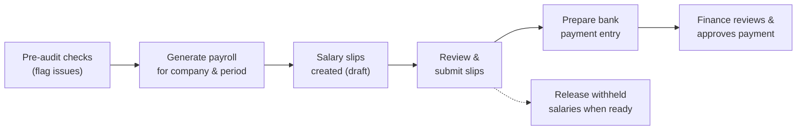

*Figure 6.1 – The payroll run. Each step is a deliberate action, so nothing is paid without review.*

**Pre-audit checks** run before payroll is generated and flag:

- employees with **no salary structure** (they would get no slip)
- employees on an **inactive salary structure**
- **zero base salary**
- **net pay zero or negative**
- **no bank account** on file
- salary slips **still in draft**
- **joiners** and **leavers** in the period (prorated pay)

---

## 7. Centralized Monitoring and Operational Control

### 7.1 The transfer log

Every transfer between CentHR and a company site is recorded, whether it succeeded or not. Administrators see one list covering every connected entity.

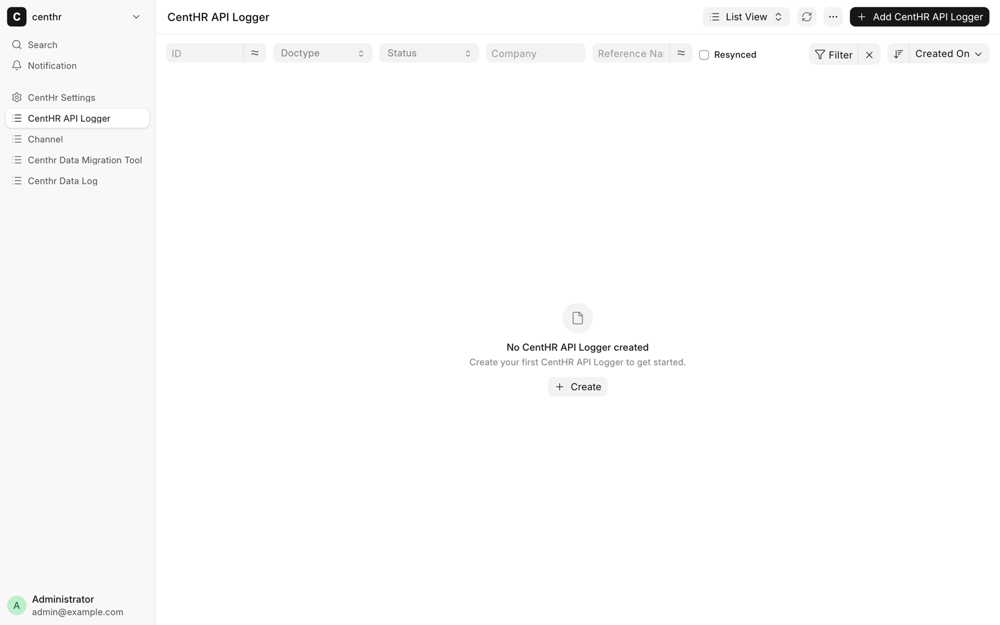

*Figure 7.1 – The transfer log (CentHR API Logger). Each entry shows the type of record, the employee or record name, the company, the status and, for failures, a plain-language reason. (Empty in the demonstration environment, which has no connected sites.)*

| What it shows | Why it matters |
|---|---|
| **Company** | See instantly which company's site a transfer was for |
| **Status: Pending, Success or Failed** | Find problems at a glance |
| **Readable error message** | Act on failures without technical help. The technical details are kept separately for IT. |
| **Resync** information | See whether a failure has already been retried, and how many times |

### 7.2 Monitoring capabilities

| Capability | How CentHR provides it |
|---|---|
| **Site connection status** | Connection problems are logged with a clear message, for example "Could not connect to the CentHR server at …". The Migration Tool also warns if a company has no connected site. |
| **Employee synchronization** | The **Entity sync** panel on each employee shows the latest result and time for that employee's company site |
| **Pending updates** | Transfers run in the background shortly after a change; each is logged |
| **Failed operations** | Logged as *Failed*, with the reason, and **alert notifications** go to the designated users |
| **Resynchronization** | **Resync** on a single entry, or select many entries and resync them together. Each failure can be retried up to three times, and duplicate retries are prevented. |
| **Error monitoring** | Filter the log by status, company or record type |
| **Company-wise status** | Every log entry carries its company, so each company's health can be reviewed on its own |
| **Migration oversight** | The **Data Log** records each migration run, with totals and outcome (Section 5.9) |

### 7.3 How this keeps every site reliable

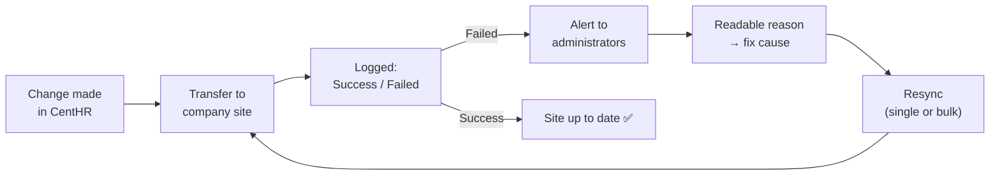

*Figure 7.2 – The control loop that keeps every company's site up to date.*

---

## 8. User Roles and Responsibilities

CentHR uses the group's existing user roles. What each user sees in the menu, and which buttons they can use, depends on their role. The system checks permissions again on every action.

| Role | Business responsibilities in CentHR | Typical access |
|---|---|---|
| **Central administrator** (System Manager) | Connects company sites; chooses who gets failure alerts; runs the Data Migration Tool; reviews and resyncs the transfer log | All companies; administration area |
| **HR management** (HR Manager) | Oversees HR across the group; gives the final approval of leave; maintains leave types, shifts, salary structures and payroll; approves attendance requests where there is no line manager | All companies they are given access to |
| **Company HR teams** (HR User, limited to their company) | Maintain employees, attendance, leave and shifts for their company | Only their own company's records |
| **Payroll teams** | Manage salary structures, assignments and payroll runs, and prepare bank payment entries. *CentHR has no separate "payroll" role: this work is done by HR users who have been given access to payroll records.* | The payroll records and companies they are given access to |
| **Heads of department** (Leave Approver) | Give the first approval or rejection of leave applications for their team | Applications where they are the named approver |
| **Reporting / line managers** | Approve or reject their team's attendance requests. Requests are shared with them automatically, with a notification. | Only the requests of employees who report to them, including employees in other companies (Section 4.4) |
| **Employees** | Submit leave and attendance requests through the self-service forms, using a one-time code sent to their company email; view their own records in CentHR | Their own records |

### 8.1 Separation between central and company responsibilities

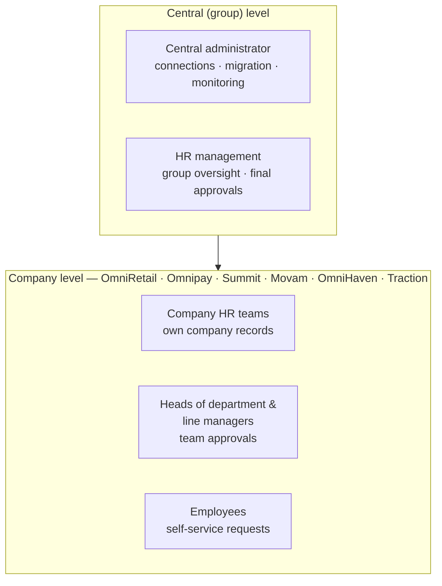

*Figure 8.1 – Central administration and oversight are separate from day-to-day work in each company.*

---

## 9. End-to-End Business Workflows

### 9.1 Connecting a new company to CentHR

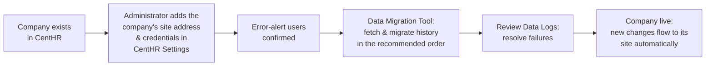

*Figure 9.1 – For example, bringing **OmniHaven** onto CentHR: connect OmniHaven's site, migrate OmniHaven's history, review the results, then go live. Any new entity the group adds later follows the same steps (Section 2.5).*

### 9.2 Creating and managing an employee

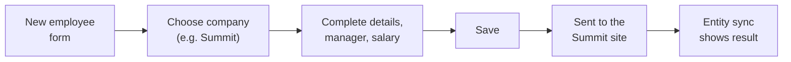

*Figure 9.2 – Creating an employee once in CentHR places them on the right company's site.*

### 9.3 Updating employee information across sites

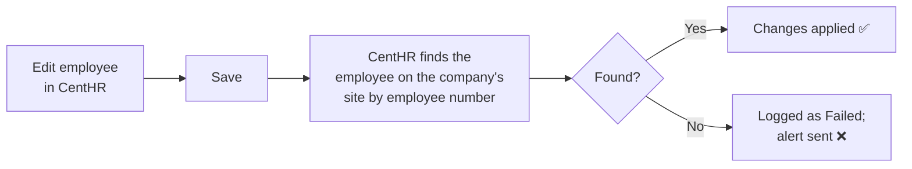

*Figure 9.3 – Employee updates are applied to the company's site automatically.*

### 9.4 Migrating employee information into CentHR

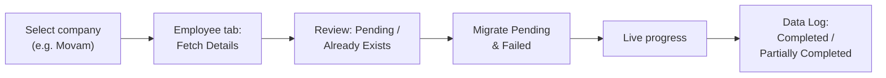

*Figure 9.4 – Bringing Movam's existing employees into CentHR. See Section 5 for the full detail.*

### 9.5 Managing attendance and leave

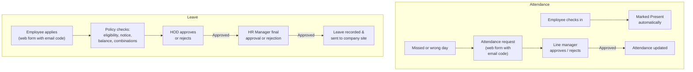

*Figure 9.5 – How attendance and leave are captured, approved and recorded.*

### 9.6 Processing payroll

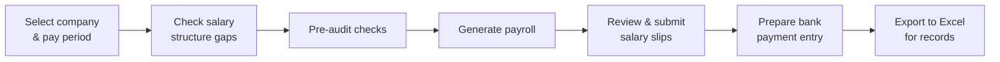

*Figure 9.6 – A controlled payroll run for one company and period, for example OmniRetail for November.*

### 9.7 Handling failed synchronization

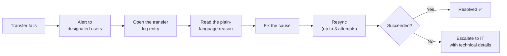

*Figure 9.7 – The recovery process for a failed transfer.*

### 9.8 Monitoring all connected companies

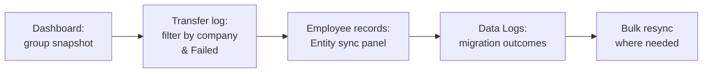

*Figure 9.8 – A routine monitoring pass across OmniRetail, Omnipay, Summit, Movam, OmniHaven and Traction.*

---

## 10. Business Benefits

| Benefit | How CentHR delivers it |
|---|---|
| **Centralized visibility** | One dashboard and one set of lists across all group entities, filterable by company |
| **Reduced administrative workload** | Enter once; bulk shift and salary assignment; automatic attendance from check-ins; automatic leave credits; Excel import and export |
| **Consistent employee information** | Company sites are kept up to date automatically from one central record |
| **Improved coordination across companies** | Cross-company reporting lines with automatic access; shared shift types and salary components |
| **Better operational control** | Logged transfers, failure alerts, resync, and payroll pre-audit checks |
| **Reduced duplication** | One entry per change; migration detects records that already exist |
| **Improved accountability** | An activity history on every record; a log of every transfer and migration; approvals recorded |
| **Simplified HR administration** | One modern interface for every HR task, with role-based menus |
| **Better management decision-making** | Current, group-wide figures on headcount, attendance, leave and payroll readiness |

> CentHR's value lies in consistency, control and visibility. This document gives no numerical savings estimates, because none have been measured yet. Section 11 suggests how to measure them.

---

## 11. Current Capabilities and Future Opportunities

### 11.1 ✅ Currently available

| Area | Verified capabilities |
|---|---|
| **Platform** | One web application for all group entities; role-based menus; light and dark themes; activity history and comments |
| **Connectivity** | Each company connected to its own site; automatic, background distribution of changes; shared definitions sent to every site |
| **Employees** | Company-prefixed IDs; full employee records; cross-company reporting with automatic access management; Entity sync status |
| **Attendance** | Records view and monthly register; bulk marking; automatic Present from the first check-in; attendance requests approved by the line manager; payroll-cycle-aware periods |
| **Leave** | Leave types, allocations and applications; the OmniRetail leave policy enforced automatically; automatic yearly credits and monthly Annual Leave accrual; HOD-then-HR approval |
| **Shifts** | Shift types; individual and bulk shift assignment; bulk processing of shift requests |
| **Payroll** | Salary components and structures; single and bulk structure assignment; salary overview with Excel export; pre-audit checks; step-by-step payroll runs; bank payment entry preparation; release of withheld salaries; salary slip import from Excel |
| **Self-service** | Leave and attendance web forms protected by a one-time code sent to the employee's company email |
| **Migration** | 15-category Data Migration Tool with preview, mapping, duplicate detection, live progress, safe stop, Data Logs and re-run |
| **Monitoring** | Transfer log with readable errors, failure alerts, and single or bulk resync (up to three attempts) |

### 11.2 💡 Areas for improvement (not yet built)

> The items below are **recommendations**. None of them exists in CentHR today.

| Theme | Suggested enhancement | Benefit to management |
|---|---|---|
| **Management dashboards** | A Board-level dashboard comparing OmniRetail, Omnipay, Summit, Movam, OmniHaven and Traction side by side: headcount, joiners and leavers, absence rate, leave liability, payroll cost | Group comparison at a glance |
| **Connection health** | A live "status board" showing each company site as online or offline, the time of the last successful transfer, and open failures | Problems spotted before users notice them |
| **Sync monitoring** | Failure trend charts by company and record type; a weekly email summary of failures | Earlier action, less firefighting |
| **Inter-company transfer** | A guided transfer that moves an employee from one company to another (for example, Movam to Summit) in one step, keeping the link to their history | Faster, cleaner internal mobility |
| **Company-to-company migration** | Copying set-up data (for example, salary structures or leave policies) directly from one company to another, with mapping of company-specific references | Faster set-up of new or restructured companies |
| **Migration experience** | One-click "onboard a company" that runs every category in order; scheduled runs; downloadable migration reports; attachment migration | Shorter onboarding and stronger audit evidence |
| **Reporting** | Standard consolidated reports (headcount, attrition, absenteeism, leave balance, payroll summary) with export | Self-service insight for management |
| **Policies by company** | Settings to apply different leave rules to each company, where the group's policies differ | Flexibility without custom work |
| **Dedicated payroll role** | A specific payroll role, separate from general HR | Clearer separation of duties |
| **Benefit measurement** | Record baseline effort (for example, hours spent on payroll each month) and track it after CentHR is adopted | Evidence-based return-on-investment reporting |

---

## 12. Final Executive Summary

<table>
<tr><td>

### What CentHR achieves
CentHR gives the group **one HR platform** for OmniRetail, Omnipay, Summit, Movam, OmniHaven and Traction. HR teams manage employees, attendance, leave, shifts, salary and payroll for every company from one place. Each company keeps its own HR site, and CentHR keeps those sites up to date automatically.

### How the group entities benefit
- **OmniRetail, Omnipay, Summit, Movam, OmniHaven and Traction** keep their independence and their own records.
- Each company receives only its own employees and transactions, quickly and reliably.
- Group-wide definitions, such as shift types and salary components, stay consistent everywhere.
- Each company's historical data can be brought into CentHR with a guided, auditable migration.
- **More entities can be added at any time.** A new entity is connected in CentHR Settings and uses the same screens, controls and monitoring, with no new development (Section 2.5).

### How central management improves operations
- **One view** of the whole workforce, with filters by company.
- **Rules applied consistently**: leave policy, approval routes and payroll pre-audit checks.
- **Problems surface early**: every transfer is logged, failures raise alerts, and recovery takes one click.
- **Less manual work**: data is entered once, assigned in bulk and processed automatically.

### The overall value
CentHR makes HR across six independent entities, and any added later, **visible, consistent and controlled**. It lowers administrative effort, reduces errors and duplication, strengthens accountability, and gives management current information for decisions. It also provides a firm base for the improvements in Section 11.

</td></tr>
</table>

---

*CentHR — Functional Overview for the Board of Directors · November 2026*

*Screenshots are from the CentHR demonstration environment and contain sample data only.*

