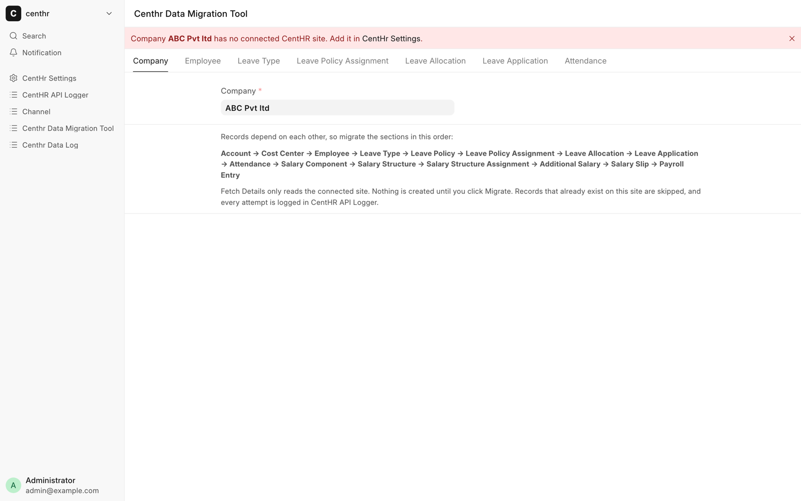
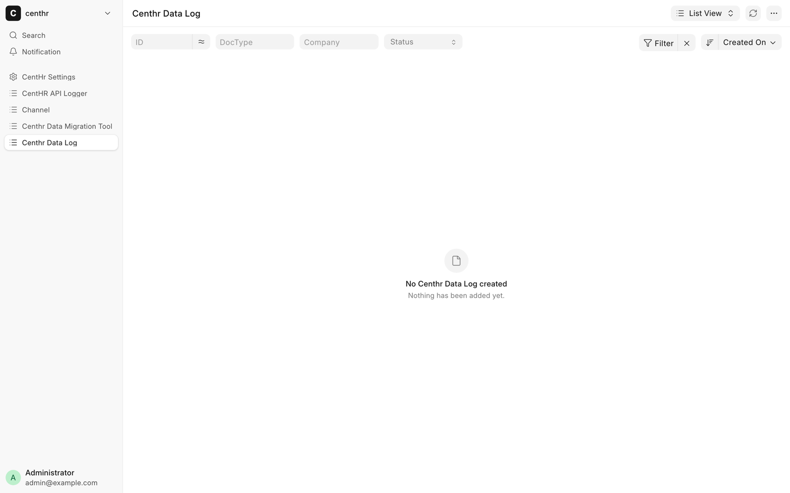

# Data Migration Tool

The Data Migration Tool copies existing records from the site of a company into CentHR, under the same company. Use it when a company joins CentHR with HR history on its own site.

The tool does not copy records from one company to a different company.

## Migration order

Records depend on each other. Migrate the categories in this order:

```mermaid
flowchart LR
    A["Account"] --> B["Cost Center"] --> C["Employee"]
    C --> D["Leave Type"] --> E["Leave Policy"] --> F["Leave Policy<br/>Assignment"] --> G["Leave Allocation"] --> H["Leave Application"] --> I["Attendance"]
    I --> J["Salary Component"] --> K["Salary Structure"] --> L["Salary Structure<br/>Assignment"] --> M["Additional Salary"] --> N["Salary Slip"] --> O["Payroll Entry"]
```

| Category | Filters |
|---|---|
| Account | Account type |
| Cost Center | — |
| Employee | Active, inactive or all |
| Leave Type, Leave Policy | — |
| Leave Policy Assignment | Date range, employee |
| Leave Allocation | Date range, employee, leave type |
| Leave Application | Date range, employee, status |
| Attendance | Date range, employee, status |
| Salary Component, Salary Structure | — |
| Salary Structure Assignment | Date range, employee |
| Additional Salary | Employee, salary component |
| Salary Slip | Date range, employee |
| Payroll Entry | Date range |

## Migrate a category

1. In Desk, search for **Centhr Data Migration Tool**.
2. Select the company. The tool reads from the site of that company in CentHR Settings. If the company has no site, the tool shows a link to CentHR Settings.
3. Open the tab of the category.
4. Set the filters.
5. Select **Fetch Details**. The tool reads the records from the company site. It does not change anything.
6. Check the status of each record.
7. Select **Migrate Selected** for the records you ticked, or **Migrate Pending & Failed** for all records not yet in CentHR.
8. Confirm.

| Status | Meaning |
|---|---|
| **Pending** | Not yet in CentHR |
| **Success** | Created in CentHR by the tool |
| **Already Exists** | A matching record is already in CentHR. The tool does not copy it again. |
| **Failed** | The last try failed. Hover over the status to see the reason. |

## During the migration

- A progress window shows the number of records done.
- Select **Stop Migration** to stop. The current record finishes and the rest are marked Stopped.
- Only one migration for each category and company can run at a time.
- A failed record does not stop the run. The tool continues with the next record.

## How records are matched

- Employees are matched by employee number. Leave, attendance and salary records link to the matching employee.
- Accounts and cost centers are matched by name and number.
- Other links are matched by name.
- If a required link does not exist, the record fails with a message, for example "Leave Type X does not exist on this site. Migrate or create it first."
- If an optional link does not exist, the field stays empty.
- The record keeps the same ID as on the company site.
- Records that were submitted on the company site are submitted in CentHR.
- Attachments are not copied.

## Check the results

Each run creates a **Centhr Data Log** entry with the totals: selected, success, already exists and failed.

| Run status | Meaning |
|---|---|
| **Completed** | Every record succeeded or already existed |
| **Partially Completed** | Some records failed |
| **Failed** | All records failed |
| **Stopped** | A user stopped the run |

To finish a run with failures:

1. Read the reason in the Data Log or on the Failed status.
2. Fix the cause. Usually, migrate a category that comes earlier in the order.
3. Select **Migrate Pending & Failed** again. The tool skips records that already succeeded.
