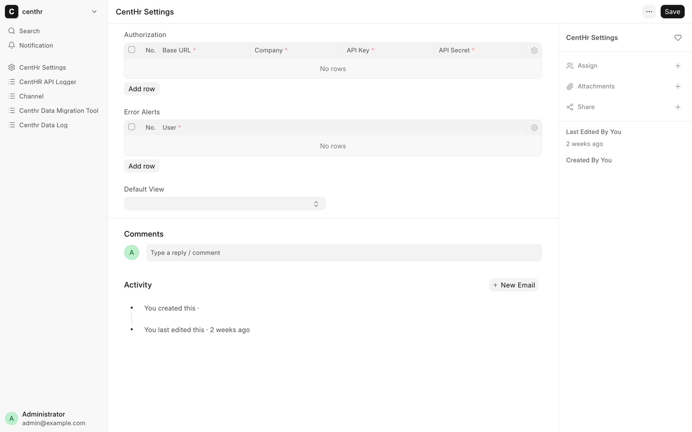

# CentHR Settings

CentHR Settings holds the connections to the company sites, the users who get failure alerts and the IOU setup. In Desk, search for **CentHR Settings**.

## Authorization

Each row of the **Authorization** table connects one company to its HR site.

| Field | Value |
|---|---|
| **Company** | The company in CentHR |
| **Base URL** | The address of the company site, for example `https://hr.company.example` |
| **API Key** | The API key of a user on the company site |
| **API Secret** | The API secret of the same user |

The user on the company site must have permission to create, change and delete the records that CentHR sends.

A company without a row does not get any data. CentHR does not queue transfers for it.

## Error Alerts

Add the users who get a notification when a transfer to a company site fails.

## IOU

| Field | Effect | Default |
|---|---|---|
| **Finance 1 (Finance Controller)** | Approves IOUs and claims at the Finance 1 stage, and pays claims | — |
| **Finance 2 (Payment Approver)** | Pays IOUs | — |
| **IOU Recovery Salary Component** | The deduction component for IOUs recovered from salary. Required for salary recovery. | — |
| **Travel: Days After Tenure to Settle** | Days after the end of the travel tenure until a travel IOU is due | 7 |
| **Other: Days After Payment to Settle** | Days after payment until an Other IOU is due | 5 |
| **Reminder Days Before Due Date** | When the employee gets the reminder to claim | 3 |
| **Salary Deduction Notice Days Before Payroll** | When overdue IOUs are scheduled for deduction | 7 |
| **Payroll Day of Month** | The payroll date. 0 means the last day of the month. | 0 |
| **Hours Before Proxy Is Notified** | How long an approver has before CentHR emails the proxy | 24 |
| **Proxies** | One row for each approver and their proxy | — |

An empty number field uses the default.

See [IOU Management](../iou) for how these settings work.
