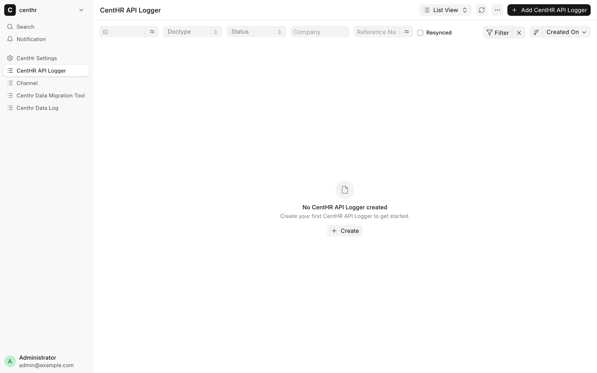
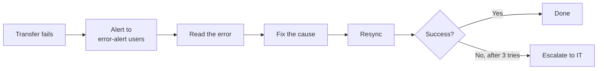

# Sync and the API Logger

CentHR sends records to the company sites in the background. It records every transfer in the **CentHR API Logger**, with its result.

## What CentHR sends

| Record | Goes to | When |
|---|---|---|
| Employee | The site of its company | Create, change, delete |
| Leave Application | The site of its company | Submit, cancel, delete |
| Leave Allocation | The site of its company | Create, change, cancel, delete |
| Attendance | The site of its company | Submit, cancel, delete |
| Employee Checkin | The site of its company | Create, change, delete |
| Shift Type | Every connected site | Create, change, delete |
| Salary Component | Every connected site | Create, change, delete |
| Salary Structure, Salary Structure Assignment, Additional Salary, Payroll Entry | The site of its company | Create, change, cancel, delete |

CentHR finds an employee on a company site by the employee number. A change to a record whose employee is not on the site fails.

## The API Logger

In Desk, search for **CentHR API Logger**. Each entry shows:

- The record type and the record name.
- The company.
- The status: **Pending**, **Success** or **Failed**.
- For a failure, an error message in plain language. The **Technical Details** field holds the full error for IT.
- The resync count.

Filter the list by status, company or record type. To check the health of one company, filter by that company and status **Failed**.

On an employee record in CentHR, the **Entity sync** panel shows the latest result for that employee.

## Resync a failed transfer

1. Read the error message on the entry.
2. Fix the cause. See the table below.
3. Select **Resync** on the entry.

To resync many entries, select them in the list and select **Actions > Resync**.

Each failed transfer can be resynced up to 3 times. After that, CentHR shows "Resync limit of 3 attempts reached". Escalate to IT with the technical details.

## Common errors

| Error | Usual cause | Fix |
|---|---|---|
| Could not connect to the site | The site is offline, or the Base URL is wrong | Check the site, or correct the Base URL in CentHR Settings. Then resync. |
| The site did not reply in time | The site is slow or busy | Resync later. |
| Authentication failed | The API key or secret changed | Update them in CentHR Settings. Then resync. |
| The site rejected the data | A value is missing or not valid on the site | Correct the record in CentHR and save it, or resync. |
| Missing fields required by the site | Department, company email, territory, cost center or channel is empty | Complete the employee record and save it. |
