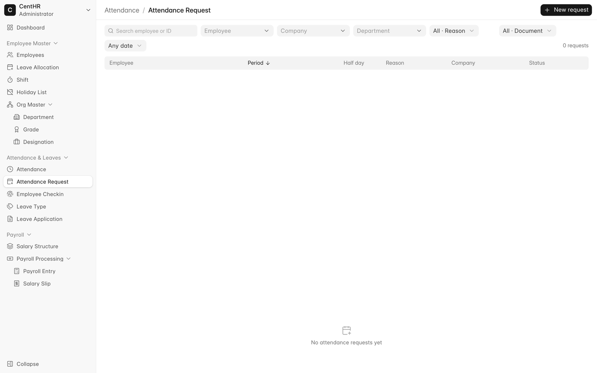

# Attendance Requests

An attendance request asks to correct the attendance of an employee. Typical reasons are a missed check-in, work from home and on duty.

## Who approves

The line manager of the employee approves or rejects the request. The line manager is the **Reports To** employee on the employee record.

CentHR shares the request with the line manager and sends a notification. The line manager does not need wider access to HR records.

If the employee has no line manager with a CentHR user, an HR manager approves the request.

## Raise a request

Employees usually raise requests through the [attendance regularization form](self-service-forms). HR users can also raise a request in CentHR:

1. In the menu, select **Attendance & Leaves > Attendance Request**.
2. Select **New request**.
3. Select the employee, the from date and the to date.
4. Select the reason and enter an explanation.
5. Select **Save**.

## Approve or reject a request

1. Open **Attendance Request**.
2. Select the **Waiting for me** filter.
3. Open a request.
4. Select **Approve** or **Reject**.

When you approve a request, CentHR updates the attendance for those days.
