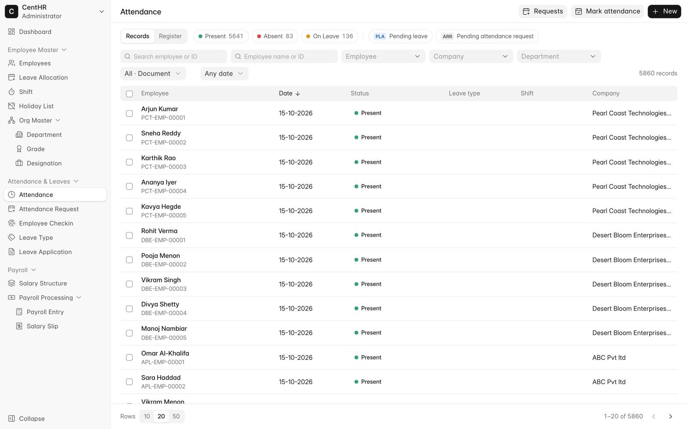

# Attendance

An attendance record holds the status of one employee on one day: Present, Absent, On Leave, Half Day or Work From Home.

## View attendance

1. In the menu, select **Attendance & Leaves > Attendance**.
2. Filter by company, department, employee, status or date.

The totals at the top count the records by status. Markers show the days that have a leave application or an attendance request that waits for approval.

## The Register view

The Register view shows one month as a grid. Each row is an employee and each column is a day. Holidays and weekly days off are shaded.

The month follows the payroll cycle of the company. For example, a cycle from the 20th to the 19th shows those dates.

## Mark attendance

1. Select **Mark attendance**.
2. Select the date or the days to mark. **All unmarked** selects every day without a record.
3. Select **Show employees**, then select the employees.
4. Select the status.
5. Select **Mark** to create the records.

You can submit or cancel many records at the same time. Select the records in the list, then select the action.

CentHR sends each submitted attendance record to the site of the company of the employee. When you cancel a record, CentHR also cancels it on the company site.

## Automatic attendance

You do not mark most attendance by hand. The first check-in of a day marks the employee Present. See [Employee Check-ins](checkins).
