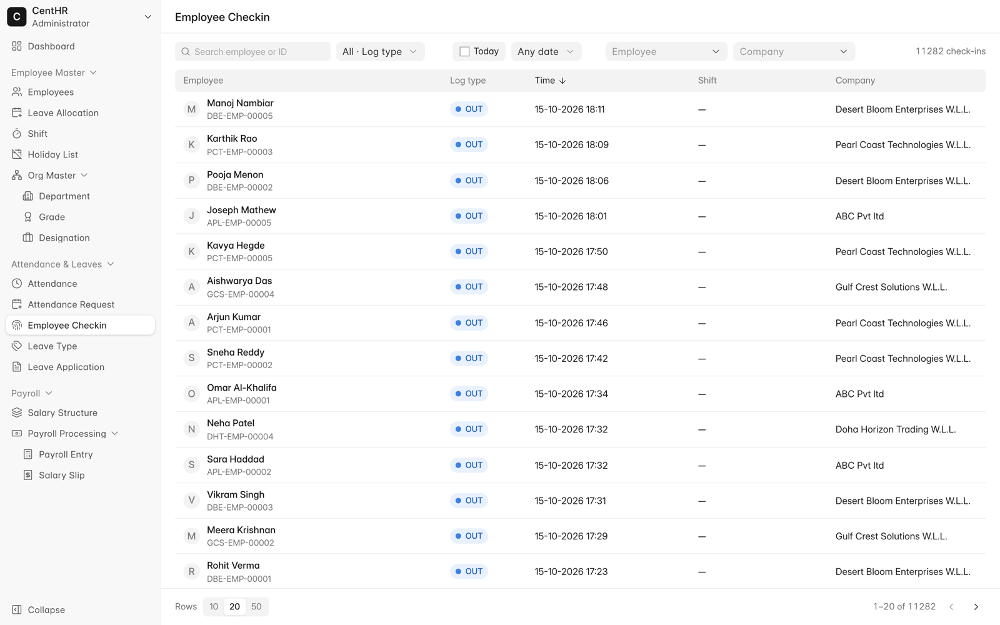

# Employee Check-ins

A check-in record holds one check-in or check-out time of an employee. Check-ins come from attendance devices or are created by hand.

## View check-ins

1. In the menu, select **Attendance & Leaves > Employee Checkin**.
2. Filter by company, employee or log type (IN or OUT).

## Automatic attendance from check-ins

When the first check-in of a day arrives, CentHR marks the employee Present for that day.

CentHR sends each check-in to the site of the company of the employee.

## Correct a missed check-in

If an employee forgot to check in, the employee raises an [attendance request](attendance-requests). Do not create a check-in to hide a missing day.
