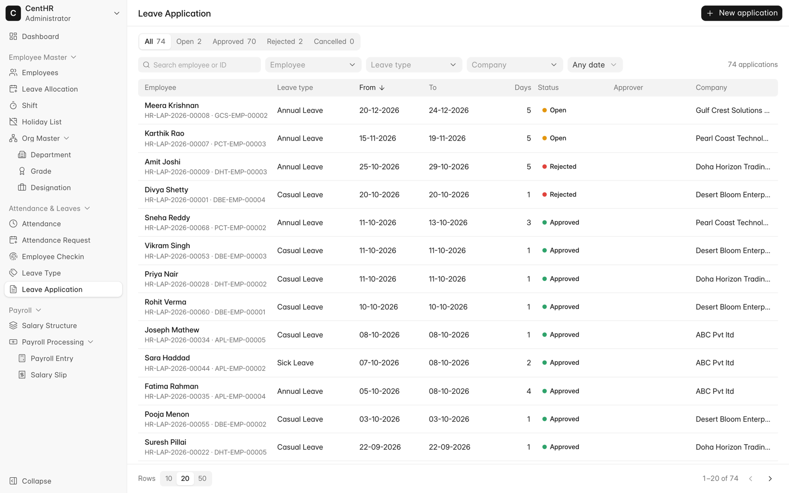
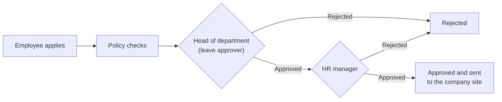

# Leave Applications

A leave application is a request for leave. It goes through two approvals: the head of department first, then HR.

## Approval flow

The leave approver on the employee record gives the first approval. An HR manager gives the final approval.

## Apply for leave

Employees usually apply through the [leave application form](self-service-forms). HR users can also apply in CentHR:

1. In the menu, select **Attendance & Leaves > Leave Application**.
2. Select **New application**.
3. Select the employee and the leave type.
4. Enter the from date and the to date.
5. Enter the reason. Attach a document if the leave type needs one.
6. Select **Save**.

CentHR checks the [leave policy](leave-policy) when you save. If a rule fails, CentHR shows the reason and does not save the application.

## Approve or reject leave

1. Open **Leave Application**.
2. Filter by status **Open**.
3. Open an application.
4. Select **Approve** or **Reject**.

When an application is approved or rejected, CentHR sends it to the site of the company of the employee. When an approved application is cancelled, CentHR also cancels it on the company site.
