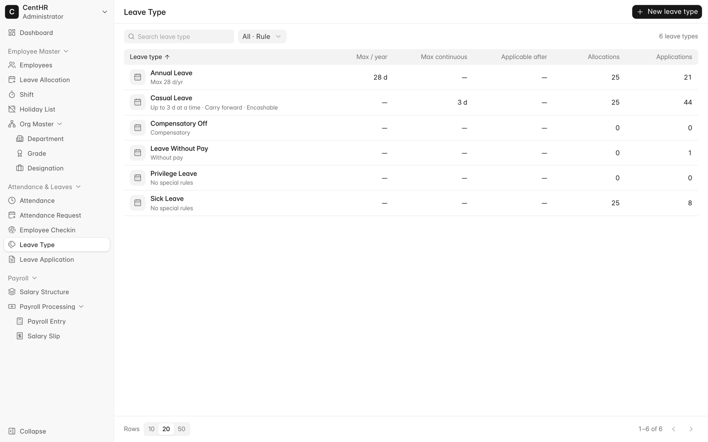

# Leave Types

A leave type is a category of leave, for example Annual Leave or Sick Leave. It holds the rules of the category.

## Maintain a leave type

1. In the menu, select **Attendance & Leaves > Leave Type**.
2. Select **New**, or open a leave type and select **Edit**.
3. Enter the maximum days in a year, the maximum continuous days and when an employee becomes eligible.
4. Select **Save**.

The list shows how many applications use each leave type.

:::note
The group leave policy is built into CentHR. It adds rules that you cannot change on the leave type form. See [Leave Policy](leave-policy).
:::
