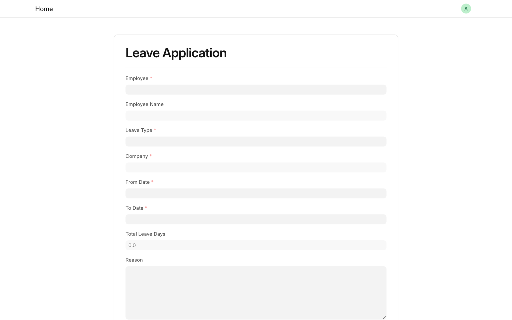

# Self-Service Forms

Employees can submit requests through web forms. They do not need a CentHR login. A one-time code sent to the company email of the employee confirms who they are.

| Form | Address | Creates |
|---|---|---|
| Leave application | `/leave-application` | A leave application |
| Attendance regularization | `/attendance` | One attendance request for each day |
| IOU application | `/iou-application` | An IOU. See [Apply for an IOU](../iou/apply) |
| IOU claim | `/iou-claim` | A claim. See [Claim Expenses](../iou/claim) |

## Submit a form

1. Open the form address on the HR site.
2. Select the company and enter your employee ID.
3. Select **Send Code**. CentHR sends a code to your company email.
4. Enter the code.
5. Complete the form.
6. Select **Submit**.

The form shows your leave balance and your leave applications that wait for approval.

## Attendance regularization

On the attendance form, you can add many days. Each day has its own reason. CentHR creates one attendance request for each day and sends it to your line manager.

## Messages you can see

| Message | What to do |
|---|---|
| "No company email is set for this employee. Contact HR." | Ask HR to add your company email to your employee record. |
| "The code has expired. Request a new code." | Send a new code. |
| "The code is not correct." | Enter the code again. Check the latest email. |
| "Too many wrong codes. Request a new code." | Send a new code. |
| "Verify the code sent to the employee's company email before you submit." | Enter the code before you submit. |
