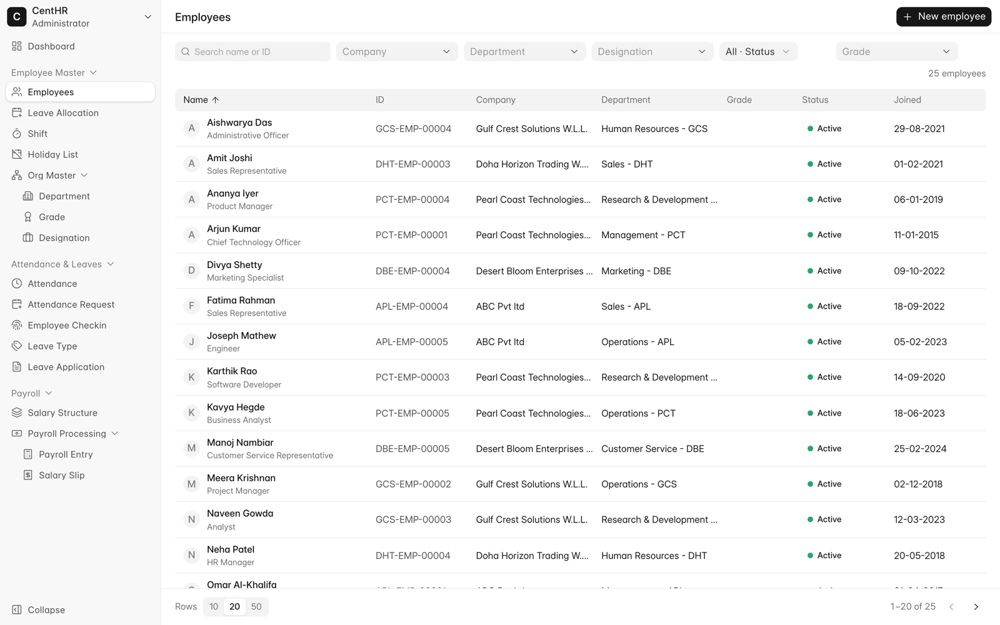
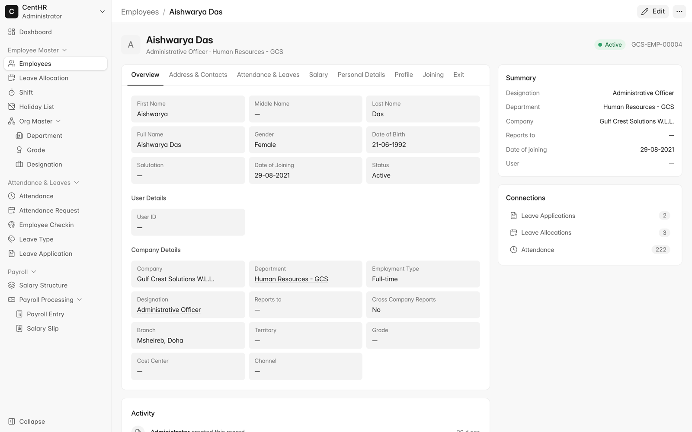

# Employees

The Employees screen is the register of all employees of all companies that you have access to. Each employee belongs to one company.

## Find an employee

1. In the menu, select **Employee Master > Employees**.
2. Type a name or an employee ID in the search box.
3. To narrow the list, filter by company, department, designation, grade or status.

## Create an employee

1. Select **New**.
2. Enter the name, gender, date of birth and date of joining.
3. Select the **Company**.
4. Enter the department, designation, grade, branch, territory, cost center, channel and company email.
5. Select the **Reports To** manager.
6. Enter the salary details: salary structure, base salary, start date and payroll payable account.
7. Select **Save**.

CentHR gives the employee an ID with the prefix of the company. Each company has its own number series, for example `OR-EMP-00012`.

After the save, CentHR sends the new employee to the site of the company in the background.

:::caution[Required for the company site]
The company site needs the department, company email, territory, cost center and channel. If one of them is empty, CentHR does not send the employee. The CentHR API Logger then shows which fields are missing. Complete the fields and save the employee again.
:::

## The employee record

The tabs hold the contact, attendance and leave, salary, personal, joining and exit details.

The side panel shows a summary and links to the leave applications, leave allocations and attendance of the employee.

## Check the sync status

When the company of the employee has a connected site, the side panel shows **Entity sync**. It shows the result of the last transfer to the company site:

- **Success**: the company site has the latest data.
- **Failed**: the transfer did not complete. The panel shows the reason.

To correct a failed transfer, see [Sync and the API Logger](../administration/sync-and-api-logger).

## Change an employee

1. Open the employee record.
2. Select **Edit**.
3. Change the fields.
4. Select **Save**.

CentHR finds the employee on the company site by the employee number and applies the same changes there.

## When an employee leaves

1. Open the employee record.
2. Set **Status** to **Left**.
3. Enter the relieving date in the exit details.
4. Select **Save**.

If you delete an employee record, CentHR also deletes the employee on the company site.

## Move an employee to a different company

CentHR does not move an employee between companies in one step. Changing the company on an existing record does not move the employee between sites.

To move an employee:

1. Set the status of the current record to **Left**.
2. Create a new employee record in the new company.

The history of the employee stays under the old company.
