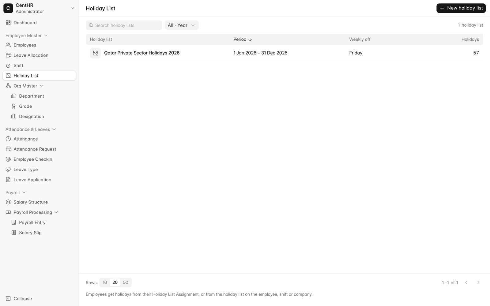

# Holiday Lists

A holiday list holds the public holidays and the weekly days off for a period. Attendance and payroll do not count these days as working days.

## Create a holiday list

1. In the menu, select **Employee Master > Holiday List**.
2. Select **New**.
3. Enter the name, the from date and the to date.
4. Select the **Company**.
5. To add the weekly days off, select the day and select **Add to Holidays**.
6. To add public holidays, select the country and, if needed, the subdivision. Then select **Add to Holidays** in the same section.
7. To add one holiday, add a row to the holidays table.
8. Select **Save**.

The buttons change the table only. CentHR shows the number of holidays it added. You must save the list to keep them.

## Make a holiday list active

Each company has one active holiday list.

1. Open the holiday list.
2. Select **Is Active**.
3. Select **Save**.

When you save an active list, CentHR does these steps:

- It deactivates the other active list of the same company.
- It sets this list on every employee of the company.

CentHR shows a message with the list it deactivated and the number of employees it changed.

:::caution
You must set the company before you make a list active. CentHR shows "Set a Company before you make this holiday list active" if the company is empty.
:::
