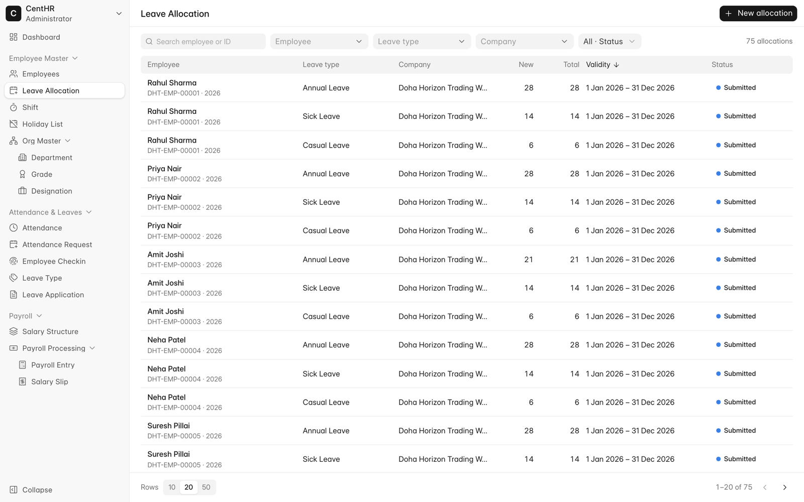

# Leave Allocations

A leave allocation gives an employee a number of days of one leave type for a period. Leave applications use the allocation as the balance.

## Automatic allocations

You do not create most allocations by hand. A daily job applies the leave policy:

- On 1 January, or on the date of joining, CentHR allocates the yearly leave types.
- Each month, CentHR adds the Annual Leave that the employee earned.
- When an employee is confirmed, CentHR gives the leave that needs confirmation.

The job catches up if it did not run on a day. See [Leave Policy](../attendance-and-leave/leave-policy) for the rules.

## Create an allocation by hand

1. In the menu, select **Employee Master > Leave Allocation**.
2. Select **New**.
3. Select the employee and the leave type.
4. Enter the from date, the to date and the number of days.
5. Select **Save**, then **Submit**.

CentHR sends the allocation to the site of the company of the employee.

## See balances

Filter the list by company, employee, leave type and status. Each row shows the period and the days allocated.
