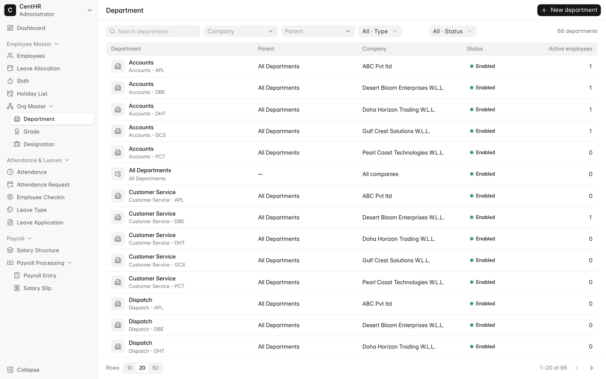
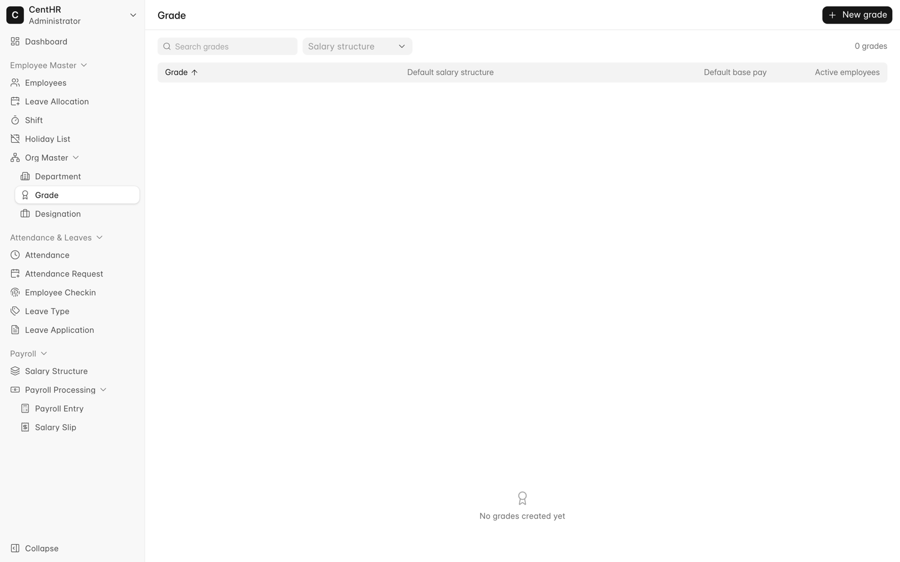

# Org Master

The Org Master screen collects the setup records that employee records use. In the menu, select **Employee Master > Org Master**, then select a card.

| Record | What it holds |
|---|---|
| **Department** | Departments and their hierarchy |
| **Grade** | Employee grades (cadres), with a default salary structure and a default base pay |
| **Designation** | Job titles |
| **Cost Center** | Cost centers for payroll accounting |
| **Channel** | The business channels that employees work in |
| **Employment Type** | Permanent, contract, intern and other types |
| **Gender** | Gender options for employee records |
| **Salary Structure** | Templates of earnings and deductions. See [Salary Structures](../payroll/salary-structures) |

You see only the cards of the records that you can read.

Each list shows how many active employees use each record.

## Grades and pay

The grade of an employee sets:

- The default salary structure and the default base pay. [Bulk Salary Structure Assignment](../payroll/salary-structure-assignments) uses them as suggestions.
- The yearly Annual Leave entitlement. See [Leave Policy](../attendance-and-leave/leave-policy).

