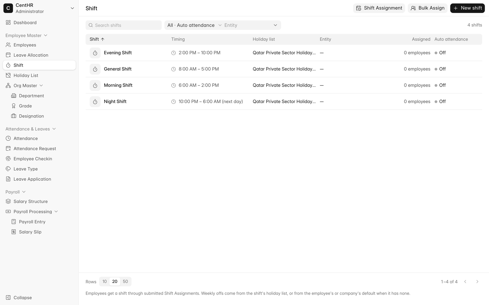
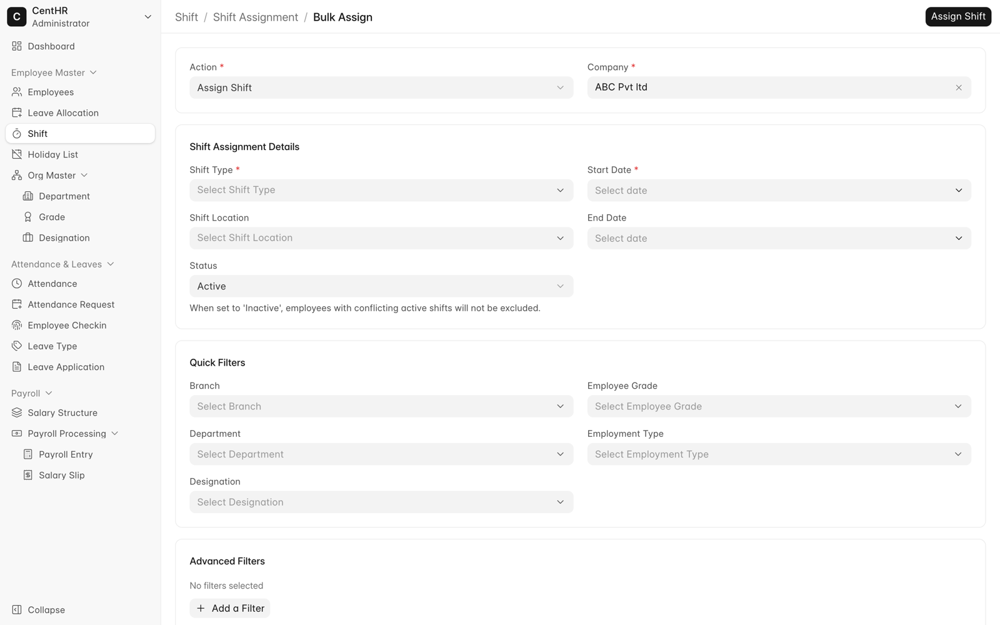

# Shifts

A shift type defines working hours. A shift assignment links an employee to a shift type for a period.

## Create a shift type

1. In the menu, select **Employee Master > Shift**.
2. Select **New**.
3. Enter the name, the start time and the end time.
4. Select the holiday list.
5. To mark attendance from check-ins, select **Enable Auto Attendance**.
6. Select **Save**.

Shift types do not belong to a company. CentHR sends each shift type to every connected company site, so all companies use the same definitions.

## Assign a shift to one employee

1. On the Shift screen, select **Shift Assignment**.
2. Select **New**.
3. Select the employee, the shift type and the start date.
4. Select **Save**, then **Submit**.

## Assign a shift to many employees

Use the Shift Assignment Tool.

1. On the Shift screen, select **Bulk Assign**.
2. In **Action**, select **Assign Shift**.
3. Select the company, the shift type and the start date.
4. To narrow the employees, select **Add a Filter**, for example by department or branch.
5. Select the employees.
6. Select **Assign Shift**, then confirm.

The list shows only employees who do not have a shift assignment for these dates.

To assign a shift schedule instead of one shift type, select **Assign Shift Schedule** in **Action**.

## Approve or reject shift requests

1. On the Shift Assignment Tool, in **Action**, select **Process Shift Requests**.
2. Select the requests.
3. Select **Process Requests**, then **Approve** or **Reject**.

CentHR processes the requests in the background. Large batches can take a few minutes.
