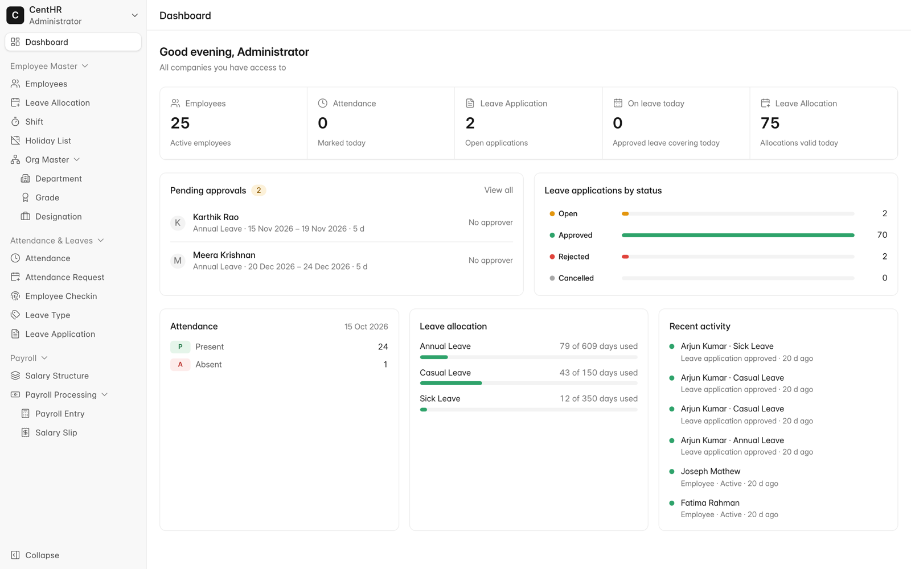

# The Dashboard

The Dashboard is the first screen after you sign in. It shows a summary of HR activity for every company that you have access to.

## What the Dashboard shows

| Item | What it counts |
|---|---|
| Active employees | Employees with the status Active |
| Attendance today | Attendance records marked for today |
| Open leave applications | Leave applications that wait for approval |
| On leave today | Employees with approved leave that covers today |
| Valid leave allocations | Leave allocations that cover today |
| Pending approvals | Requests that wait for your action |
| Leave applications by status | Open, approved and rejected leave applications |
| Attendance today by status | Present, absent, on leave, half day and work from home |
| Leave used against allocated | Days used and days allocated, for each leave type |
| Recent activity | The latest changes to HR records |

## Use the Dashboard

Select a figure or an item to open the records behind it. For example, select **Open leave applications** to open the list of leave applications that wait for approval.

HR users see the records of all the companies they have access to. Other users see only their own records.
