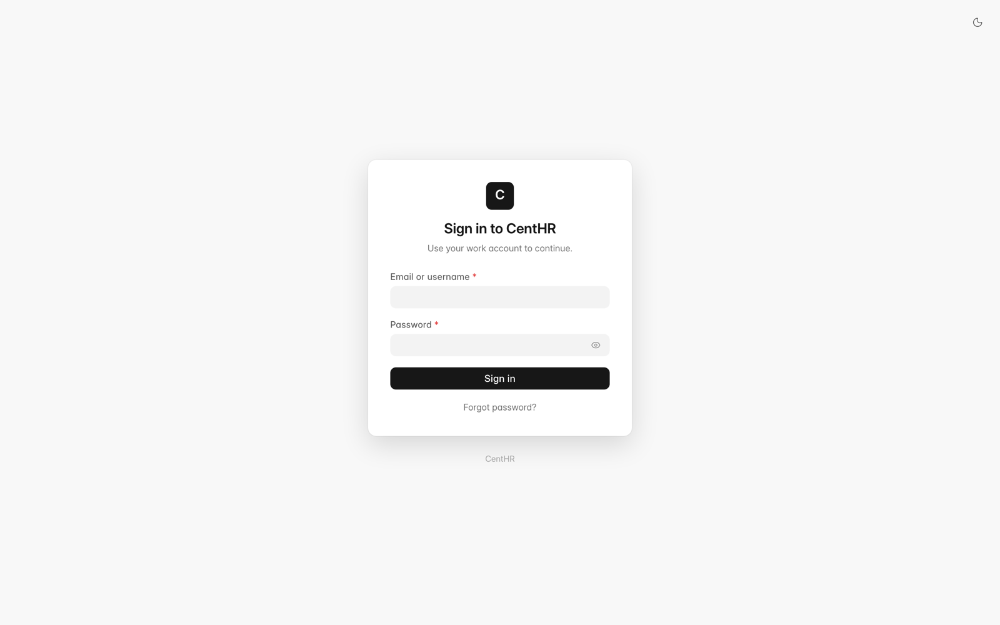

# Signing In

CentHR is a web application. You open it in a browser at the `/centhr` address of the HR site.

## Open CentHR

1. Open the HR site in your browser.
2. Go to `/centhr`, or select **CentHR** on the apps screen.
3. Enter your email address and password.
4. Select **Sign in**.

CentHR opens the [Dashboard](dashboard).

If you open a CentHR link before you sign in, CentHR shows the sign-in page first. After you sign in, CentHR opens the page of the link.

## When your session ends

When your session expires, CentHR shows the sign-in page again. Sign in again to go back to the page you had open.

## Employees without a CentHR login

Employees do not need a login to apply for leave, correct attendance or apply for an IOU. They use the [self-service forms](../attendance-and-leave/self-service-forms).
