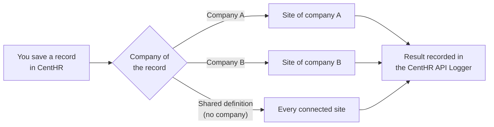

# CentHR Documentation

CentHR is the central HR application of the group. HR teams use it to manage the employees, attendance, leave, shifts, payroll and IOUs of every group company in one place.

Each company keeps its own HR site. When you save a change in CentHR, CentHR sends the change to the site of that company in the background. You enter the data one time only.

## Sections

| Section | Read it to |
|---|---|
| [Getting Started](getting-started) | Sign in, find your way around and understand your access |
| [Employee Master](employee-master) | Manage employees, shifts, holiday lists and the organization structure |
| [Attendance and Leave](attendance-and-leave) | Record attendance, approve requests and manage leave |
| [Payroll](payroll) | Assign salary structures, check payroll and run it |
| [IOU Management](iou) | Apply for, approve, pay and settle IOUs |
| [Administration](administration) | Connect company sites, watch transfers and migrate data |

## How CentHR connects to the company sites

:::note
The screenshots in this documentation come from a demonstration site. The company and employee names are sample data.
:::
