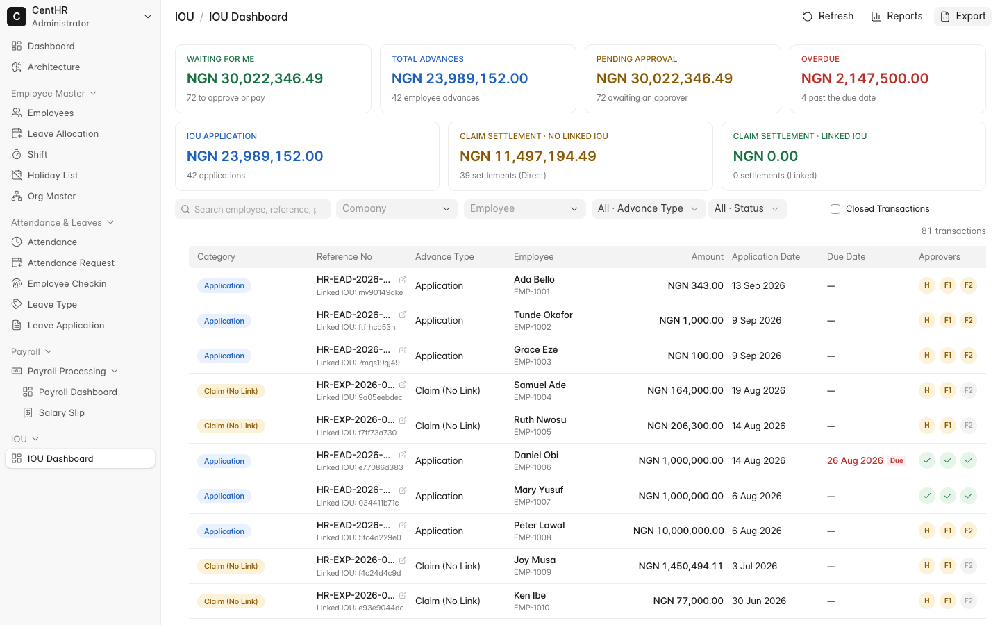

# IOU Dashboard

The IOU Dashboard shows all IOU applications and claims in one table. Approvers and Finance users act on them here. HR and Finance use it to follow outstanding and overdue IOUs.

In the menu, select **IOU > IOU Dashboard**.

## Who sees which rows

The dashboard shows the IOUs and claims that you have permission to read. An approver who has only the Employee role sees the documents that are shared with them for approval. See [Roles and Access](../getting-started/roles-and-access).

## Summary cards

The first row of cards shows the totals for the current filters. Each card shows an amount and a count.

| Card | What it counts |
|---|---|
| **Waiting for Me** | Documents that you can approve or pay now |
| **Total Advances** | IOU applications (employee advances) |
| **Pending Approval** | Documents that wait for an approver |
| **Overdue** | Paid IOUs past their due date that are not settled |

The second row shows the three categories:

| Card | What it counts |
|---|---|
| **IOU Application** | Requests for an IOU |
| **Claim Settlement · No Linked IOU** | Claims for expenses that the employee paid from pocket |
| **Claim Settlement · Linked IOU** | Claims that settle an IOU |

Select a card to show only its rows. The **Showing** line under the cards names the active card filters. Select **✕** on a filter, or select the card again, to remove it. You can use one card from each row at the same time.

## Filters

| Filter | Use |
|---|---|
| Search | Find by employee, reference number, purpose, linked IOU or status |
| **Company** | Show one company |
| **Employee** | Show one employee. The list follows the selected company. |
| **Advance Type** | Show one category |
| **Status** | Show one status |
| **Closed Transactions** | Also show closed documents |

The table hides closed documents by default. A document is closed when:

- An IOU is claimed, returned, partly claimed and returned, or cancelled.
- A claim is paid, rejected or cancelled.

The count above the table shows how many rows match. Select **Clear** in the filter bar to remove all filters.

## The table

| Column | What it shows |
|---|---|
| **Category** | Application, Claim (No Link) or Claim (Linked) |
| **Reference No** | The document number. A second line shows the linked IOU. |
| **Employee** | The employee name and ID |
| **Amount** | The amount. For a claim that settles an IOU, a second line shows the part settled from the IOU (IOU) and the part paid to the employee (Pocket). For an IOU, **Bal** shows the outstanding amount. |
| **Application Date** | The date of the application |
| **Due Date** | The settlement due date of a paid IOU. A red **Due** label marks an overdue IOU. |
| **Approvers** | One circle for each stage: **H** (HOD), **F1** (Finance 1) and **F2** (Finance 2) |
| **Status** | The status of the document |
| **Actions** | The buttons for the actions you can do |

Select a column heading to sort by that column.

### Approver circles

| Circle | Meaning |
|---|---|
| Green tick | The stage is approved |
| Red cross | The stage rejected the document |
| Amber letter | The stage waits for approval |
| Gray letter | The stage does not apply, for example F2 on a claim |

Hover over a circle to see the approver, the status and the reason for a rejection.

## Actions

The **Actions** column shows only the actions that you can do now:

- **Approve** and **Pay** show as buttons.
- **Reject** and **Modify** are in the **⋯** menu.
- **View** opens the details.
- The arrow icon opens the document in Desk.

See [Approve and Pay](approve-and-pay) for what each action does.

## Document details

Select a row, or **View**, to open the details. The details show:

- The employee, department, application date and due date.
- The financial details: total amount, outstanding amount, claim method and linked IOU.
- For a claim, the expense rows: claim type, cost center, amount and receipt.
- The **Approval Trail**: who approved or rejected each stage, and when.

The action buttons are also in the details window.

## Reports and export

- **Reports** opens the **IOU Advance Summary** or the **IOU Advance Report** in Desk.
- **Export** downloads the rows that the table shows now, as an Excel file. The file has the approvers of each stage.
- **Refresh** loads the data again.
