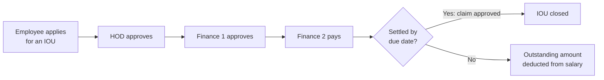

# IOU Management

An IOU is a cash advance that the company pays to an employee before an expense, for example for travel. The employee later settles the IOU with an IOU claim that shows how the money was spent.

In CentHR:

- An **IOU application** is an Employee Advance.
- An **IOU claim** is an Expense Claim. An expense claim without an IOU is a claim **from pocket**.

| Page | Read it to |
|---|---|
| [Apply for an IOU](apply) | Request an IOU as an employee |
| [Claim Expenses](claim) | Settle an IOU, or claim expenses paid from your own pocket |
| [IOU Dashboard](dashboard) | Find, filter, follow and export IOUs and claims |
| [Approve and Pay](approve-and-pay) | Act on IOUs and claims as an approver or Finance user |
| [Due Dates and Salary Recovery](due-dates-and-recovery) | Understand reminders and deductions from salary |
| [IOU Settings](../administration/settings#iou) | Set the approvers, proxies and time limits |

## The life of an IOU

