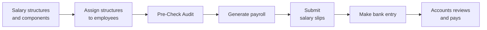

# Payroll

Payroll in CentHR has two parts. First, you decide how each employee is paid: the salary structure, the start date and the base pay. Then, each pay cycle, you check the data and run payroll for each company.

| Page | Read it to |
|---|---|
| [Salary Structures and Components](salary-structures) | Maintain the pay templates and their earnings and deductions |
| [Salary Structure Assignments](salary-structure-assignments) | Link employees to a structure, one at a time or in bulk |
| [Payroll Dashboard](payroll-dashboard) | Check the pay cycle before and after the run |
| [Run Payroll](run-payroll) | Generate, submit and pay a payroll run |
| [Salary Slips](salary-slips) | View, change and import salary slips |
| [Statutory Compliance](compliance) | Track and pay statutory obligations |

