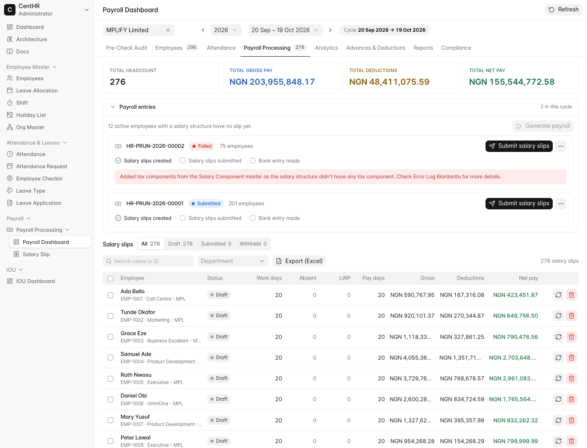
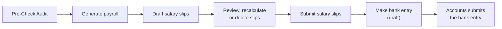

# Run Payroll

You generate and run payroll on the **Payroll Processing** tab of the [Payroll Dashboard](payroll-dashboard). A payroll run is one payroll entry for one company and one pay cycle. You move it forward one step at a time. Nothing is paid until Accounts submits the bank entry.

## Before you start

1. Make sure every active employee has a salary structure assignment. See [Salary Structure Assignments](salary-structure-assignments).
2. Make sure attendance and leave for the cycle are complete.
3. Make sure the company has a **Default Payroll Payable Account**. CentHR shows "Set the Default Payroll Payable Account of company … first" if it is empty.
4. Open the **Pre-Check Audit** tab and fix the problems that it shows.

To generate payroll, your role needs permission to create and submit Payroll Entry. Without it, the **Generate payroll** button does not show.

## Select the company and the cycle

1. In the menu, select **Payroll > Payroll Processing > Payroll Dashboard**.
2. Select the company. You must select one company to generate payroll.
3. Select the year and the pay period. Use the arrows to go to the previous or next period.
4. Check the **Cycle** label. It shows the first and the last day of the cycle.
5. Open the **Payroll Processing** tab.

## The Payroll Processing tab

The tab has three parts:

- **Totals:** total headcount, gross pay, deductions and net pay of the cycle. Each card shows the change against the last cycle.
- **Payroll entries:** the payroll runs of the cycle, with the **Generate payroll** button.
- **Salary slips:** the slips of the cycle, with filters and actions.

## Generate payroll

1. In **Payroll entries**, read the line "*n* active employees with a salary structure have no slip yet." These are the employees the new run pays.
2. Select **Generate payroll**.
3. Read the confirmation. It names the company, the cycle and the number of employees.
4. Select **Generate**.

CentHR creates a monthly payroll entry for the cycle and submits it. HRMS then creates a draft salary slip for each employee. The entry uses these defaults of the company: payroll payable account, cost center, currency and default bank account.

For more than 30 employees, HRMS creates the slips in the background. The run card shows "Working in the background. This updates by itself." Wait until the message goes away.

**Generate payroll** is not available when:

- No company is selected.
- No employee is left without a slip.
- The company already has a payroll entry in this cycle. CentHR does not create a second entry for the same company and period.

## The run card

Each payroll entry has a card. The card shows:

- The entry number. Select it to open the payroll entry.
- The status and the number of employees.
- Three stages: **Salary slips created**, **Salary slips submitted** and **Bank entry made**. A green tick marks a stage that is done.
- The button for the next step.
- The bank entries that the run made, as Draft or Submitted. Select one to open it in Desk.

## Steps of a run

The card shows one step button at a time.

| Button | What it does |
|---|---|
| **Submit payroll** | Shows only for a draft payroll entry. Submits the entry and creates the draft salary slips. |
| **Create salary slips** | Shows when a submitted entry has no slips. Creates the slips again. |
| **Submit salary slips** | Submits all draft slips of the run. This books the payroll accrual. You cannot change the slips after this step. |
| **Make bank entry** | Creates a draft bank entry that pays the salaries. |
| **Release withheld salaries** | Shows when the run has withheld salaries and a bank entry. Creates the bank entry for the withheld salaries. |

A confirmation shows before each step.

## Review the salary slips

Do this before you select **Submit salary slips**.

1. Under **Salary slips**, select **Draft** to show the draft slips.
2. Check the work days, absent days, leave without pay (LWP), pay days, gross pay, deductions and net pay of each slip. Absent days show in red. A net pay of zero or less shows in red.
3. To find a slip, search by name or ID, or filter by department.
4. Select a row to open the slip.

To correct a draft slip:

- Select the recalculate icon on the row to compute the slip again. Do this after you change attendance, leave or a salary structure assignment.
- Select the delete icon on the row to delete the slip.

To act on many slips, select them with the checkboxes. Then select **Submit**, **Recalculate** or **Delete**. These actions change only draft slips.

Select **Export (Excel)** to download the slips that the table shows.

## Submit the salary slips

1. On the run card, select **Submit salary slips**.
2. Select **Continue**.

## Pay the salaries

1. On the run card, select **Make bank entry**.
2. In **Pay from**, select the bank or cash account. It must be an account of the same company.
3. Select **Continue**.

CentHR creates the bank entry as a draft journal entry. Accounts reviews and submits it in Desk.

## Pay withheld salaries

A salary put on hold on the **Pre-Check Audit** tab gets a salary slip with the status **Withheld**. The first bank entry does not pay it.

When you are ready to pay these salaries:

1. On the run card, select **Release withheld salaries**.
2. In **Pay from**, select the account.
3. Select **Continue**.

CentHR creates a second draft bank entry for the withheld salaries. Accounts reviews and submits it.

## When a step fails

If a step fails, the run status is **Failed** and the card shows the error in red. Fix the cause, then select the step button again.

For example, "Added tax components from the Salary Component master as the salary structure didn't have any tax component" means that the salary structure has no tax component. Add it to the salary structure, then recalculate the slips.

## Cancel a run

1. On the run card, select **⋯ > Cancel payroll**.
2. Confirm.

CentHR deletes the salary slips of the run and cancels its journal entries. Only users who can cancel Payroll Entry see this option.

CentHR sends each payroll entry to the site of its company.
