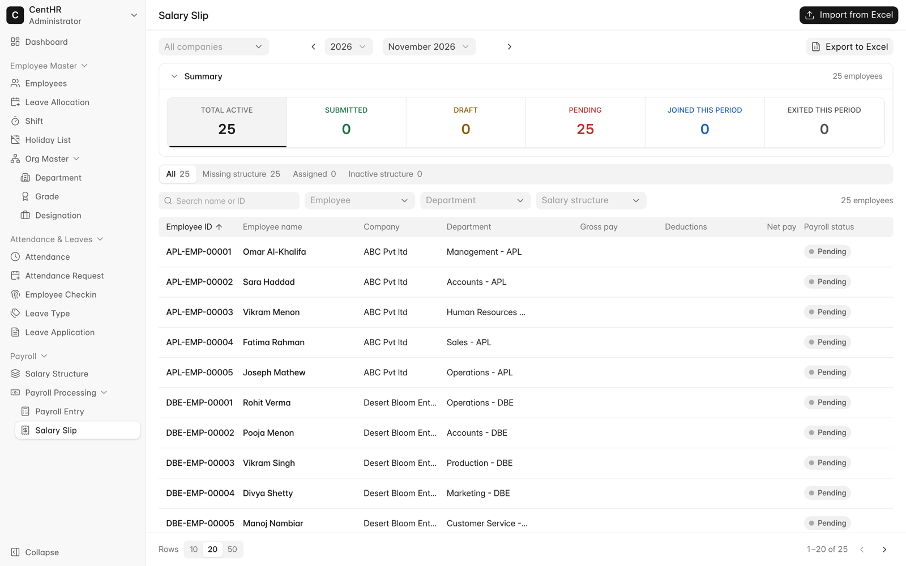

# Salary Slips

A salary slip holds the pay of one employee for one pay cycle: the earnings, the deductions and the net pay.

## View salary slips

1. In the menu, select **Payroll > Payroll Processing > Salary Slip**.
2. Filter by company, period, employee or status.
3. Select a row to open the slip.

You can change a slip only while it is a draft.

## Import salary slips from Excel

Use the import when the salaries were calculated outside CentHR.

1. On the Salary Slip screen, select **Import from Excel**.
2. Select **Download Excel template**. The template has the slip columns and a column for each earning and deduction.
3. Fill in one row for each slip.
4. Select the file (.xlsx or .csv).
5. Select **Import as draft**.

CentHR creates the slips as drafts, so you can check them before you submit. The import shows how many slips it created and how many failed. If rows failed, select **Download failed rows**, correct the file and import it again.
