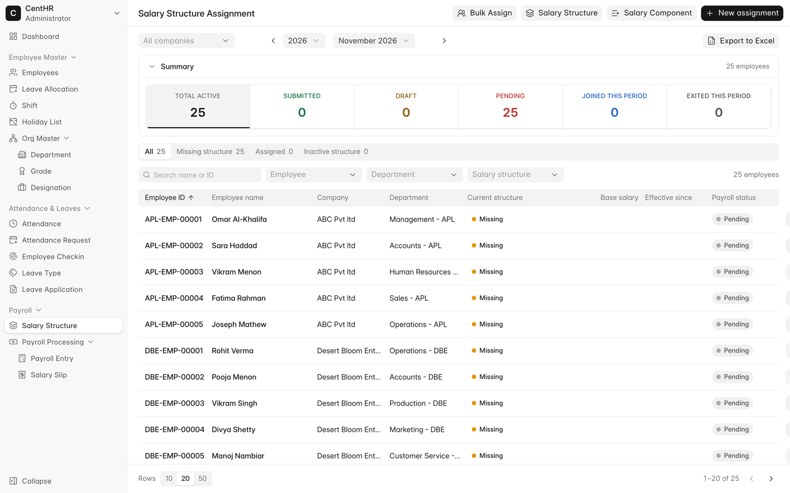
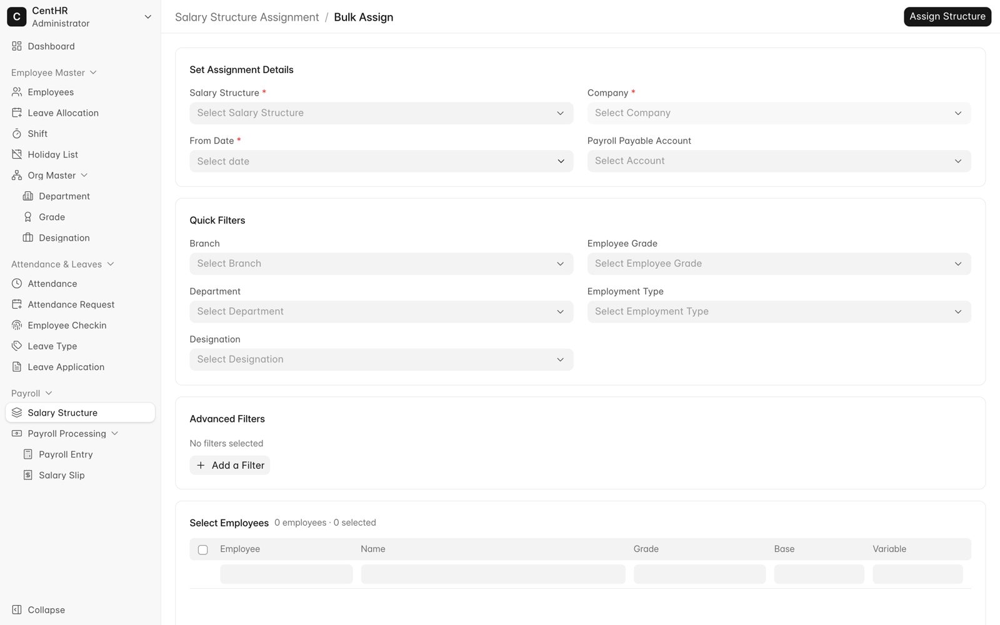

# Salary Structure Assignments

A salary structure assignment links an employee to a salary structure from a start date, with a base pay and a variable pay. An employee without an assignment gets no salary slip.

## The Salary Structure Assignment screen

To open the screen, open a salary structure in **Org Master** and select its assignments link. You can also go to `/centhr/salary-structure-assignments`. The **Employees** tab of the [Payroll Dashboard](payroll-dashboard) shows the same table.

The screen shows one company and one pay period. The cards count: total active, submitted, draft, pending, joined this period and exited this period.

The table lists every employee with the current structure, the date it is effective from and the payroll status. Use the view filter to show **All**, **Assigned**, **Missing structure** or **Inactive structure**. Use **Missing structure** to find the employees to fix before you run payroll.

The top bar opens **Bulk Assign** and **Salary Component**. **Export to Excel** downloads the table.

## Assign a structure to one employee

1. On the Salary Structure Assignment screen, select **New assignment**.
2. Select the employee, the salary structure and the from date.
3. Enter the base and, if needed, the variable pay.
4. Select **Save**, then **Submit**.

To change an assignment, select **Edit** on the row of the employee.

## Assign a structure to many employees

1. Select **Bulk Assign**.
2. Select the company, the salary structure and the from date.
3. Select the employees. CentHR suggests the default base pay of the grade of each employee.
4. Change the base and the variable pay where needed.
5. Select **Assign Structure**.

CentHR creates and submits one assignment for each employee. It sends each assignment to the site of the company.
