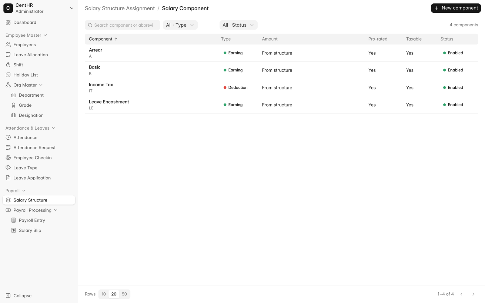

# Salary Structures and Components

A **salary component** is one earning or one deduction, for example Basic or Pension. A **salary structure** is a template that combines components and their formulas.

## Salary components

The list shows the type (earning or deduction) of each component, and if it is taxable and pro-rated.

To create a component:

1. On the Salary Structure Assignment screen, select **Salary Component** in the top bar.
2. Select **New**.
3. Enter the name and the abbreviation.
4. Select the type: Earning or Deduction.
5. Select **Save**.

Salary components do not belong to a company. CentHR sends each component to every connected company site.

## Salary structures

1. In the menu, select **Employee Master > Org Master > Salary Structure**.
2. Select **New**.
3. Select the company and the payroll frequency.
4. Add the earnings and deductions, with their amounts or formulas.
5. Select **Save**, then **Submit**.

CentHR sends the structure to the site of its company.

On a structure record, the link to its assignments opens the employees who are on this structure.

:::note
Change a submitted structure only by cancelling it and amending it. Employees on the old structure keep it until you assign the new one.
:::
